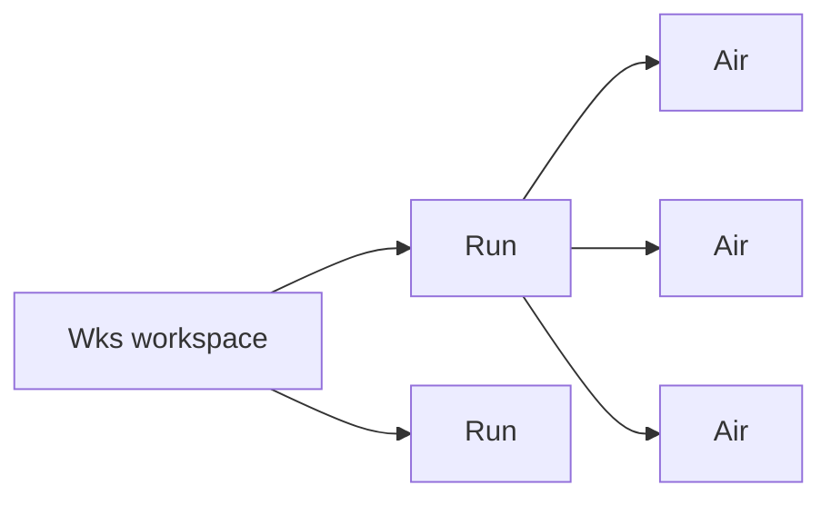
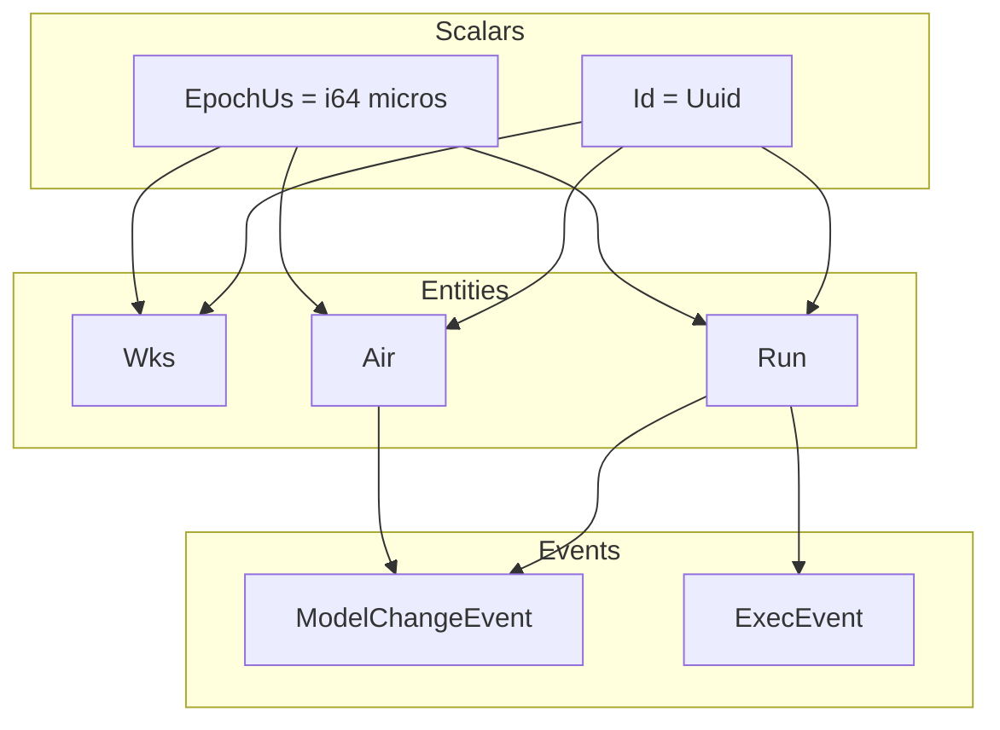

# 02 -- Domain Model

The domain model is the shared vocabulary of zcoder. Every crate speaks it, but only one
defines it. `zc-core` holds the entities, the scalar types, and the event contracts. It does
no persistence and no execution. This document opens each type and shows how they connect.

## The Three Entities

The daemon stores three kinds of record. A `Wks` is a workspace: one directory on disk. A
`Run` is one user prompt and its outcome. An `Air` is one AI request inside a run. The names
follow the author's short, quirky style: "Wks" for workspace, "Air" for AI request, "Run"
for a prompt run.

The relationship is a tree. One workspace has many runs. One run has many AI requests.



### Wks

`Wks` is the smallest entity. It holds an id, two timestamps, a directory, and an optional
label.

```rust
// crates/zc-core/src/model/entities/wspace.rs:10
pub struct Wks {
    pub id: Id,
    pub ctime: EpochUs,
    pub mtime: EpochUs,
    pub dir: String,
    pub label: Option<String>,
}
```

The `dir` field is the workspace's absolute path on disk. `label` is a short human-readable
name such as `dev/zcoder`. Both `ctime` (create time) and `mtime` (modify time) are stored
for every entity, in microseconds since the Unix epoch.

### Run

`Run` is one prompt and everything it produced. It is the parent of the `Air` requests.

```rust
// crates/zc-core/src/model/entities/run.rs:10
pub struct Run {
    pub id: Id,
    pub wspace_id: Option<Id>,
    pub ctime: EpochUs,
    pub mtime: EpochUs,
    pub prompt: Option<String>,
    pub answer: Option<String>,
    pub error: Option<String>,
    pub end: Option<EpochUs>,
    pub end_state: Option<String>,
    pub total_cost: Option<f64>,
    pub air_idx_seq: i64,
}
```

`air_idx_seq` is a counter. It numbers the `Air` requests inside the run, starting at 1.
`total_cost` is the sum of every child `Air` cost, in dollars. The executor recomputes it
after each AI request. `end_state` holds one of `success`, `error`, or `cancelled`.

### Air

`Air` is the largest entity. It records one AI request: what was asked, what the model
answered, how many tokens were used, what it cost, and how long it took.

```rust
// crates/zc-core/src/model/entities/air.rs:15
pub struct Air {
    pub id: Id,
    pub run_id: Id,
    pub wspace_id: Option<Id>,
    pub idx: i64,

    pub label: Option<String>,

    pub ctime: EpochUs,
    pub mtime: EpochUs,

    pub start: Option<EpochUs>,
    pub ai_start: Option<EpochUs>,
    pub ai_end: Option<EpochUs>,
    pub end: Option<EpochUs>,

    pub model_ov: Option<String>,
    pub model_upstream: Option<String>,
    pub prompt_json: Option<String>,
    pub answer_json: Option<String>,
    pub usage_json: Option<String>,

    pub token_in: Option<i64>,
    pub token_out: Option<i64>,
    pub token_reason: Option<i64>,
    pub token_cache_hit: Option<i64>,
    pub token_cache_write: Option<i64>,

    pub cost: Option<f64>,

    pub error: Option<String>,
    pub end_state: Option<String>,
}
```

The fields group into four concerns. Identity: `id`, `run_id`, `wspace_id`, `idx`. Timing:
`ctime`, `mtime`, `start`, `ai_start`, `ai_end`, `end`. Model I/O: `model_ov`,
`model_upstream`, `prompt_json`, `answer_json`, `usage_json`. Cost: `token_*`, `cost`. The
four timestamps after `mtime` record the phases of one request. `start` is when the request
began. `ai_start` and `ai_end` bracket the model call itself. `end` is when the request
finished. The difference between `start` and `end` is total time. The difference between
`ai_start` and `ai_end` is model time only.

`model_ov` is the model name as the user requested it (the "override"). `model_upstream` is
the real model the provider received after alias resolution. `prompt_json`, `answer_json`,
and `usage_json` store raw provider payloads for debugging and replay.

## The Scalar Types

Two wrapper types appear everywhere. They are "newtypes": a single field wrapped in a new
struct for type safety.

```rust
// crates/zc-core/src/model/types/id.rs:7
#[mra::derive(Debug, ScalarStruct!)]
pub struct Id(Uuid);

// crates/zc-core/src/model/types/epoch_us.rs:5
#[mra::derive(Debug, ScalarStruct!)]
pub struct EpochUs(i64);
```

`Id` wraps a `uuid::Uuid`. Its default is `Uuid::nil()`, the all-zero UUID. This matters for
routing, as [01-architecture.md](./01-architecture.md) shows. `EpochUs` wraps an `i64` of
microseconds since the Unix epoch. `EpochUs::now()` computes it directly.

```rust
// crates/zc-core/src/model/types/epoch_us.rs:8
pub fn now() -> Self {
    let duration = std::time::SystemTime::now()
        .duration_since(std::time::UNIX_EPOCH)
        .unwrap_or_default();
    EpochUs(duration.as_micros() as i64)
}
```

Both types implement `SqliteFromValue` and `SqliteToValue`. That means rusqlite can read and
write them directly. `Id` is stored as a 16-byte BLOB. The round-trip test in `id.rs`
confirms this exact byte length.

## The Naming Mismatch

Here the code takes a surprising turn. The Rust struct names and the database names do not
match.

| Rust struct | SQL table | `EntityType` variant |
|-------------|-----------|----------------------|
| `Air` | `aixc` | `Aixc` |
| `Run` | `run` | `Run` |
| `Wks` | `wspace` | `Wks` |

The enum makes the split explicit:

```rust
// crates/zc-core/src/model/entities/common.rs:5
pub enum EntityType {
    Run,
    Aixc,
    Wks,
}
```

The table names come from the BMC controllers in `zc-base`, documented in
[04-persistence.md](./04-persistence.md). Each controller declares both names as constants:

```rust
// crates/zc-base/src/model/bmc/air_bmc.rs:14
impl DbBmc for AirBmc {
    const TABLE: &'static str = "aixc";
    const ENTITY_TYPE: EntityType = EntityType::Aixc;
}
```

So `Air` is the Rust-facing name, `aixc` is the SQL-facing name, and `Aixc` is the
event-facing name. One concept, three spellings, three audiences. The Rust code is the only
place the word `Air` is spelled that way.

**Aha:** The three-spelling split is a deliberate discipline, not an accident. The struct
name reads well in Rust. The table name is short for SQL. The `EntityType` variant is the
wire-facing identifier that survives serialization. By giving each layer its own spelling
and forcing the BMC to declare the mapping, the author makes any mismatch loud at one place
instead of silent across three. This is why the grandfather review checks names so hard: a
drift between `Air`, `aixc`, and `Aixc` would corrupt events without breaking a compile.

## RelIds: Routing the Events

Events must say which workspace and run a record belongs to. `RelIds` carries that pair.

```rust
// crates/zc-core/src/model/entities/common.rs:12
pub struct RelIds {
    pub run_id: Option<Id>,
    pub wspace_id: Option<Id>,
}
```

`RelIds` is not stored in the entity. It is attached to `ModelChangeEvent` at publish time.
A `Run` event has a `wspace_id` but no `run_id`. An `Air` event has both. The TUI uses these
ids to decide which part of the screen to refresh, as [08-tui-core.md](./08-tui-core.md)
shows.

## The ForCreate / ForUpdate Split

Each entity has two companion structs. `RunForCreate`, `RunForUpdate`, `AirForCreate`,
`AirForUpdate`, `WksForCreate`. They hold only the fields a caller is allowed to set, and
every field is `Option` or has a default. The create struct omits `id`, `ctime`, and
`mtime`. Those are filled by the persistence layer. The update struct makes every field
optional so a caller can change one field without touching the rest.

```rust
// crates/zc-core/src/model/entities/run.rs:26
#[derive(Debug, Default, Clone, Fields, SqliteFromRow, Serialize, Deserialize)]
pub struct RunForCreate {
    pub wspace_id: Option<Id>,
    pub prompt: Option<String>,
    pub answer: Option<String>,
}
```

`RunForCreate` has three fields. `Run` has eleven. The create path cannot set `air_idx_seq`
or `total_cost`, because those are derived. This is the core idea of the domain layer:
types encode *what may be written* separately from *what is stored*.

## ModelChangeEvent

Every create and update publishes a `ModelChangeEvent`. The event is cheap to clone because
it wraps its data in an `Arc`.

```rust
// crates/zc-core/src/model/bus/model_event.rs:8
#[derive(Debug, Clone, Deref, Serialize, Deserialize)]
#[serde(transparent)]
pub struct ModelChangeEvent(Arc<ModelEventData>);

#[derive(Debug, Clone, PartialEq, Eq, Serialize, Deserialize)]
pub struct ModelEventData {
    pub entity: EntityType,
    pub action: EntityAction,
    pub id: Option<Id>,
    pub rel_ids: RelIds,
}
```

`EntityAction` has three variants: `Created`, `Updated`, `Deleted`. Note the `id` is
`Option<Id>`. A batch create publishes one event with `id: None`, meaning "many rows
changed, refresh the list" rather than "one row changed".

```rust
// crates/zc-core/src/model/bus/model_event.rs:32
pub enum EntityAction {
    Created,
    Updated,
    Deleted,
}
```

The `#[serde(transparent)]` means the outer struct serializes as its inner `ModelEventData`.
When the event crosses the socket as postcard bytes, the `Arc` wrapper disappears. Only the
four fields remain.

## ExecReq, ExecCmd, ExecEvent

The domain layer also defines the executor's contract. An `ExecReq` is a command sent to the
executor. It has a workspace id and a command.

```rust
// crates/zc-core/src/exec/exec_event.rs:7
pub struct ExecReq {
    pub wspace_id: Id,
    pub cmd: ExecCmd,
}

pub enum ExecCmd {
    RunPrompt(String),
}
```

Right now there is exactly one command: `RunPrompt(String)`. The string is the raw prompt
text. More commands can be added later without changing the envelope.

The executor reports progress with `ExecEvent`.

```rust
// crates/zc-core/src/exec/exec_event.rs:28
pub enum ExecEvent {
    RunStart(Id),
    RunEnd(Id),
    RunError(Id),
}
```

Each variant carries a `Run` id. `RunStart` fires when a run begins. `RunEnd` fires on
success. `RunError` fires on failure. The TUI uses these to move a run through its UI states.
This contract flows end to end in [11-data-flow.md](./11-data-flow.md).

## The Derive Aliases

The scalar types get most of their behavior from two macro aliases in `derive_aliases.rs`.

```rust
// crates/zc-core/src/derive_aliases.rs:3
derive_alias! {
    #[derive(Cmp!)] = #[derive(PartialEq, Eq, PartialOrd, Ord)];
}
```

`Cmp!` bundles the four comparison traits. It exists so a scalar type can be `Copy`,
`Hash`, `Ord`, and comparable in one line without repeating the four derives.

```rust
// crates/zc-core/src/derive_aliases.rs:15
derive_alias! {
    #[derive(ScalarStruct!)] = #[derive(
        crate::Cmp!,
        Clone,
        Copy,
        Hash,
        derive_more::From,
        derive_more::Into,
        derive_more::Display,
        derive_more::Deref,
        modql::SqliteFromValue,
        modql::SqliteToValue,
        serde::Serialize,
        serde::Deserialize,
    )];
}
```

`ScalarStruct!` adds eleven behaviors to a newtype in one derive. Two of them matter most:
`Deref` lets a scalar be used like its inner type, and `SqliteFromValue`/`SqliteToValue` let
rusqlite read and write it directly. That is how `Id` flows into a SQL `BLOB` column and
`EpochUs` into an `INTEGER` column without any manual conversion code. The macro aliases are
the reason the domain layer stays so thin: the types are one line each, and the traits come
from the alias.

## How It Fits Together

The three layers of meaning stack cleanly.



Scalars are the atoms. Entities compose them. Events reference the entities by `EntityType`
and `RelIds`. Nothing in this layer allocates a thread, opens a file, or touches SQL. That
is the whole point of the `zc-core` crate: pure meaning, no side effects.

## Where This Is Headed

The persistence layer in [04-persistence.md](./04-persistence.md) turns these structs into
SQL rows and publishes the `ModelChangeEvent`s. The executor in [05-executor.md](./05-executor.md)
drives `ExecReq` through `Run` and `Air` and emits `ExecEvent`s. The config in
[03-config-system.md](./03-config-system.md) resolves the `model_ov` string before it is
stored on an `Air`.
