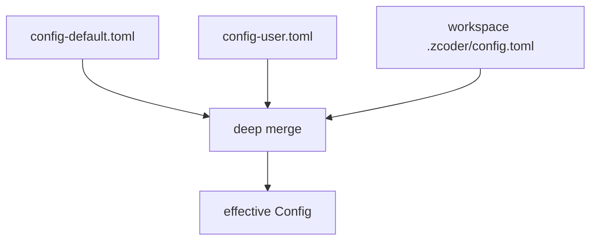
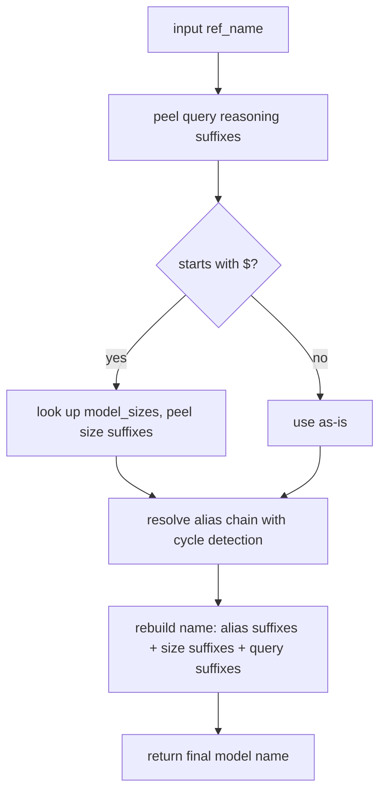

# 03 -- Config System

The config system answers one question over and over: "which model does this workspace
use?" It layers three TOML files, merges them with a JSON deep-merge, resolves aliases to
real model names, and hot-reloads on file change. This document walks that pipeline.

## The Problem It Solves

One user wants a cheap model for a toy project and a big model for work. A team wants every
member's machine to share defaults, but let each project override them. A raw `config.toml`
per project solves neither. zcoder needs a layered config where a more specific file wins
over a more general one, without any file knowing about the others.

The answer is three layers, merged in order.



Later layers override earlier ones. `config-default.toml` ships inside the binary.
`config-user.toml` lives in the base directory. The workspace `.zcoder/config.toml` lives in
the project itself. The workspace file is the most specific, so it wins.

## The Config Type

`Config` is a cheap handle around an `Arc`, so it can be cloned and shared freely.

```rust
// crates/zc-base/src/config/config_impl.rs:13
#[derive(Debug, Clone, Default)]
pub struct Config(Arc<ConfigInner>);
```

The real data is `ConfigInner`. It has four sections.

```rust
// crates/zc-base/src/config/config_impl.rs:25
#[serde(from = "ConfigToml", into = "ConfigToml")]
pub struct ConfigInner {
    pub maestro_model: Option<String>,
    pub wspace: Option<WspaceConfig>,
    pub model_sizes: Option<BTreeMap<String, String>>,
    pub model_aliases: Option<BTreeMap<String, String>>,
}
```

`maestro_model` is the default model for the "maestro" orchestration loop. `wspace` holds
the workspace working directory. `model_sizes` maps size words like `small`, `medium`,
`big` to model names. `model_aliases` maps short aliases to real model names.

The `#[serde(from = "ConfigToml", into = "ConfigToml")]` line is important. It means the
TOML on disk has one shape, and the Rust struct has another. `ConfigToml` maps `workspace`
to the TOML key, while `ConfigInner` calls it `wspace`. The conversion is explicit.

```rust
// crates/zc-base/src/config/config_impl.rs:318
struct ConfigToml {
    #[serde(rename = "workspace")]
    wspace: Option<WspaceConfigToml>,
    maestro: Option<MaestroToml>,
    model_sizes: Option<BTreeMap<String, String>>,
    model_aliases: Option<BTreeMap<String, String>>,
}
```

So a config file looks like this:

```toml
[maestro]
model = "$small"

[workspace]
working_dir = "crates/zc-core"

[model_sizes]
small = "lite"
big   = "sol"

[model_aliases]
lite  = "gemini-3.5-flash-lite"
sol   = "gpt-5.6-sol"
```

## The Layering Algorithm

The merge is not a TOML-level merge. Each file is parsed to TOML, converted to JSON, and the
JSON values are merged deeply.

```rust
// crates/zc-base/src/config/config_impl.rs:147
pub fn layer_toml_strs_layers(layers: &[&str]) -> Result<Self> {
    let mut merged_json = serde_json::Value::Object(serde_json::Map::new());
    for layer in layers {
        let layer_toml_val: toml::Value = toml::from_str(layer)?;
        let layer_json: serde_json::Value =
            serde_json::to_value(layer_toml_val).map_err(|e| Error::custom(e.to_string()))?;
        merged_json = zc_common::jsons::merge(merged_json, layer_json);
    }
    let inner: ConfigInner = serde_json::from_value(merged_json).map_err(|e| Error::custom(e.to_string()))?;
    Ok(inner)
}
```

Why TOML to JSON to merge? Because JSON has a well-defined recursive merge semantics, and
`zc_common::jsons::merge` already implements it. TOML has no native deep-merge. Converting
to JSON reuses that code instead of writing a TOML merger. The final JSON is deserialized
back into `ConfigInner`.

The merge is "later wins, recursively". A map field in a later layer extends the earlier
map. This is why the three-tier test works: `model_aliases` in the workspace file adds new
keys and overrides existing keys, but leaves untouched keys from the base intact.

## Model Name Resolution

This is the heart of the system. `get_model` turns a user-facing reference into a real model
name. The reference can be a size preset (`$small`), an alias (`lite`), a chain of aliases
(`chain_a`), or a raw name. It can carry a reasoning suffix (`-high`).

The algorithm runs in three phases.



Here is the real code, abridged to the core.

```rust
// crates/zc-base/src/config/config_impl.rs:190
pub fn get_model(&self, ref_name: &str) -> Result<String> {
    let trimmed = ref_name.trim();
    if trimmed.is_empty() {
        return Ok(String::new());
    }

    let (trimmed_base, query_suffixes) = peel_reasoning_suffixes(trimmed);
    let mut size_suffixes = Vec::new();

    // 1. Check size preset if starts with '$'
    let target = if let Some(size_key) = trimmed_base.strip_prefix('$') {
        let size_val = self.model_sizes.as_ref()
            .and_then(|sizes| sizes.get(size_key))
            .map(|s| s.as_str())
            .ok_or_else(|| Error::ModelSizeNotFound(trimmed_base.to_string()))?;
        let (size_base, s_suffixes) = peel_reasoning_suffixes(size_val);
        size_suffixes = s_suffixes;
        size_base
    } else {
        trimmed_base
    };

    // 2. Resolve alias chain with cycle detection
    let mut current = target;
    let mut visited = HashSet::new();
    visited.insert(current);
    let mut alias_hops_suffixes: Vec<Vec<&str>> = Vec::new();

    for _ in 0..MAX_ALIAS_DEPTH {
        if let Some(aliased) = self.model_aliases.as_ref().and_then(|aliases| aliases.get(current)) {
            let (next, a_suffixes) = peel_reasoning_suffixes(aliased);
            alias_hops_suffixes.push(a_suffixes);
            if visited.contains(next) {
                return Err(Error::ModelAliasCycle(format!(
                    "Circular model alias detected for '{trimmed_base}' at '{next}'"
                )));
            }
            visited.insert(next);
            current = next;
        } else {
            break;
        }
    }

    // 3. Rebuild
    let mut model = current.to_string();
    for hop_suffixes in alias_hops_suffixes.into_iter().rev() {
        for suffix in hop_suffixes { model.push_str(suffix); }
    }
    for suffix in size_suffixes { model.push_str(suffix); }
    for suffix in query_suffixes { model.push_str(suffix); }
    Ok(model)
}
```

Three details deserve attention. First, cycle detection uses a `HashSet` of visited names.
If a chain loops back to a name it has seen, it returns `Error::ModelAliasCycle`. The loop
is also bounded by `MAX_ALIAS_DEPTH` to catch a cycle that is longer than the visited set
would reveal. Second, reasoning suffixes are peeled from every hop, then re-appended in the
correct order. A chain `a = "b-low"`, `b = "c-medium"` resolves `a-high` to
`base-model-medium-low-high`. Third, the suffix order matters: alias suffixes come first,
then size suffixes, then the query's own suffixes.

### The Reasoning Suffixes

A reasoning suffix tunes how hard the model thinks. There are exactly seven.

```rust
// crates/zc-base/src/config/config_impl.rs:9
const REASONING_SUFFIXES: [&str; 7] = ["-zero", "-none", "-low", "-medium", "-high", "-xhigh", "-max"];
```

`peel_reasoning_suffixes` strips any of these from the end of a name, repeatedly, and
returns the base plus the list of stripped suffixes. A raw name that merely ends in `-max`
is handled correctly because the suffix is peeled and re-appended, so `qwen3.8-max` stays
`qwen3.8-max`.

## Hot Reload

The config can change on disk while the daemon runs. `ConfigManager` watches for that. It
stores the current config in an `ArcSwap`, so readers get a lock-free snapshot.

```rust
// crates/zc-base/src/config/manager.rs:11
pub struct ConfigManager {
    config_path: SPath,
    default_config_path: Option<SPath>,
    current: ArcSwap<ConfigInner>,
    last_mtimes: Mutex<BaseMtimes>,
}
```

`refresh_if_modified` compares the file modification times against the last seen times. If
they differ, it re-reads and re-layers the files, then atomically swaps in the new
`ConfigInner`. Readers holding an old `Config` keep using it; new readers get the new one.
This is copy-on-write config.

```rust
// crates/zc-base/src/config/manager.rs:118
if current_mtimes.config_mtime.is_some() && current_mtimes == *last_mtimes_guard {
    return Ok(false);
}
// ... re-layer and store ...
self.current.store(Arc::new(new_inner));
```

A failed reload keeps the old config. The test `test_config_manager_load_and_reload` writes
`"invalid toml [["` and confirms the previous config is still served. A syntax error never
takes the daemon down.

## Workspace Resolution

Config is resolved per workspace. `resolve_for_wspace` looks up the workspace id, gets its
directory, and layers the workspace config on top of the base configs.

```rust
// crates/zc-base/src/config/manager.rs:84
pub fn resolve_for_wspace_dir(&self, wspace_id: Id, wspace_dir: &SPath) -> Result<Config> {
    tracing::debug!("->> resolving fresh config for wspace_id {wspace_id}");
    let wspace_config_path = wspace_dir.join(".zcoder").join("config.toml");
    self.layer_wspace_config(&wspace_config_path)
}
```

Two cases short-circuit to the base config: a `None` workspace id, and `Id::default()` (the
nil UUID). Both mean "no workspace yet, use the global defaults". An unknown workspace id
logs a warning and falls back to the base config rather than erroring.

The workspace config is read fresh from disk on every resolution. The base layers are cached
behind `refresh_if_modified`, but the workspace layer is not cached at all. This means
editing `.zcoder/config.toml` and re-running the same prompt picks up the change
immediately, with no refresh call.

## The Embedded Default

When no base files exist, the manager writes the default config from an asset embedded in
the binary.

```rust
// crates/zc-base/src/config/manager.rs:201
fn embedded_default_config_toml() -> Result<&'static str> {
    static DEFAULT_CONFIG_TOML: OnceLock<String> = OnceLock::new();
    if let Some(content) = DEFAULT_CONFIG_TOML.get() {
        return Ok(content.as_str());
    }
    let content = zc_asset::extract_asset_str(DEFAULT_CONFIG_ASSET).map_err(Error::custom_from_err)?;
    let content = DEFAULT_CONFIG_TOML.get_or_init(|| content);
    Ok(content.as_str())
}
```

The asset name is `base/config-default.toml`. The result is cached in a `OnceLock`, so the
asset is extracted from the binary exactly once per process. `zc_asset` is documented in
[10-bootstrap-lifecycle.md](./10-bootstrap-lifecycle.md).

## The Aha Moment

**Aha:** Model alias resolution is suffix-aware, not string-replacing. A naive
implementation would do `aliases.get(name)` and return the value. This one peels the
reasoning suffix off *before* the lookup, resolves the base name through the chain, then
re-appends the suffix. That is why `$small-high` works even though no key is literally
`small-high`. The suffix is a first-class part of the model grammar, handled by one function,
not a special case at every call site. The 24 tests in `config_impl.rs` exist mostly to pin
down this one subtlety.

## Where This Is Headed

The resolved model name lands on an `Air.model_ov` field, described in
[02-domain-model.md](./02-domain-model.md). The executor reads the config through
`ConfigManager` before each run, described in [05-executor.md](./05-executor.md). The
`ArcSwap` hot-reload pattern reappears in the event loop of
[08-tui-core.md](./08-tui-core.md), where the same copy-on-write trick serves the UI.
