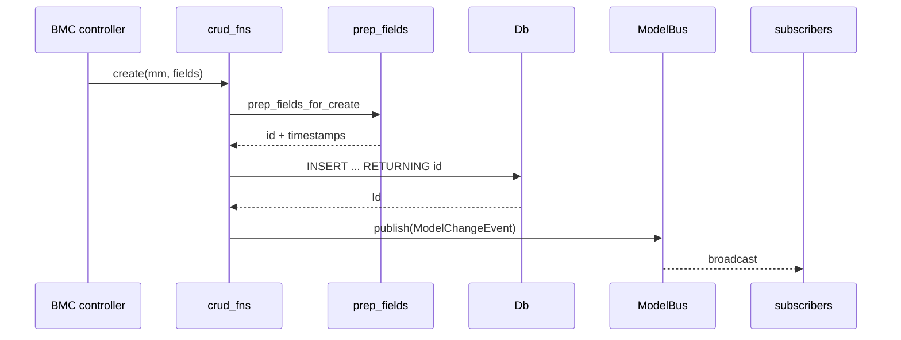

# 04 -- Persistence

The daemon stores its three entities in SQLite. The database is in-memory, the schema is
strict, and every write publishes an event. This document shows the schema, the generic CRUD
layer, the BMC controllers, and the broadcast bus.

## The Problem It Solves

A coding agent has three kinds of state: which workspaces exist, what runs happened, and what
each AI request cost. This state must survive the client, so it lives in the daemon, not the
TUI. It must be queryable fast. It must notify every client when it changes. zcoder answers
with SQLite, a thin generic CRUD layer, and a broadcast channel.

The database is in-memory today. The `Db` constructor opens `Connection::open_in_memory()`.

```rust
// crates/zc-base/src/model/db/db_impl.rs:20
pub fn new() -> Result<Self> {
    let con = Connection::open_in_memory()?;
    recreate_db(&con)?;
    let con = Arc::new(Mutex::new(con));
    Ok(Self { con })
}
```

In-memory means the data dies when the daemon stops. The code comments acknowledge this:
"Currently, the database is in-memory only, but it may become persistent at the session
level." [12-cross-cutting.md](./12-cross-cutting.md) explains what a durable version adds.

## The Schema

Three tables: `run`, `aixc`, `wspace`. Every table is declared `STRICT, WITHOUT ROWID` with
an `id BLOB PRIMARY KEY`.

```sql
-- crates/zc-base/src/model/db/db_setup.rs:24
CREATE TABLE IF NOT EXISTS run (
        id          BLOB PRIMARY KEY,
        wspace_id   BLOB,
        prompt      TEXT,
        answer      TEXT,
        error       TEXT,
        ctime       INTEGER NOT NULL,
        mtime       INTEGER NOT NULL,
        end         INTEGER,
        end_state   TEXT,
        model       TEXT,
        total_cost  REAL,
        air_idx_seq INTEGER NOT NULL DEFAULT 0
) STRICT, WITHOUT ROWID;
```

```sql
-- crates/zc-base/src/model/db/db_setup.rs:47
CREATE TABLE IF NOT EXISTS aixc (
        id          BLOB PRIMARY KEY,
        run_id      BLOB NOT NULL,
        wspace_id   BLOB,
        idx         INTEGER NOT NULL,
        label       TEXT,
        ctime       INTEGER NOT NULL,
        mtime       INTEGER NOT NULL,
        start       INTEGER,
        ai_start    INTEGER,
        ai_end      INTEGER,
        end         INTEGER,
        model_ov    TEXT,
        model_upstream TEXT,
        prompt_json TEXT,
        answer_json TEXT,
        error       TEXT,
        end_state   TEXT,
        usage_json  TEXT,
        token_in    INTEGER,
        token_out   INTEGER,
        token_reason INTEGER,
        token_cache_hit INTEGER,
        token_cache_write INTEGER,
        cost        REAL
) STRICT, WITHOUT ROWID;
```

```sql
-- crates/zc-base/src/model/db/db_setup.rs:87
CREATE TABLE IF NOT EXISTS wspace (
        id     BLOB PRIMARY KEY,
        dir    TEXT NOT NULL UNIQUE,
        label  TEXT,
        ctime  INTEGER NOT NULL,
        mtime  INTEGER NOT NULL
) STRICT, WITHOUT ROWID;
```

Four choices matter.

`STRICT` means SQLite rejects a value whose type does not match the column. A `TEXT` column
cannot silently store an integer. This catches bugs that a permissive SQLite would hide.

`WITHOUT ROWID` makes the table a clustered index on the primary key. The `id BLOB` is the
row itself, not a hidden rowid. This is faster for key lookups and smaller for wide rows.

`id BLOB` is a 16-byte UUID v7, not an integer. The `Id` type in
[02-domain-model.md](./02-domain-model.md) stores exactly this. A UUID can be generated in
the client or the daemon without a central counter, which matters when many clients race to
create rows.

`wspace.dir TEXT NOT NULL UNIQUE` enforces one row per directory at the database level. This
backstops the application-level `get_or_create_by_dir` logic.

Two details differ from the structs. The `run` table declares a `model` column that has no
field on the `Run` struct, so the generic CRUD never reads or writes it. And the header
comment in `db_setup.rs` mentions a `uid` column and `AUTOINCREMENT` that are not present in
the actual DDL; the comment is aspirational, describing a future cross-database design. The
DDL is the source of truth.

## The Db Wrapper

`Db` wraps the rusqlite connection in an `Arc<Mutex<Connection>>`, making it cheap to clone
and safe to share across async tasks.

```rust
// crates/zc-base/src/model/db/db_impl.rs:8
#[derive(Debug, Clone)]
pub struct Db {
    con: Arc<Mutex<Connection>>,
}
```

The executor methods are thin wrappers over rusqlite. The key one is `exec_in_tx`, which runs
a closure inside a transaction and commits or rolls back based on its result.

```rust
// crates/zc-base/src/model/db/db_impl.rs:34
pub async fn exec_in_tx<R, F>(&self, f: F) -> Result<R>
where
    F: FnOnce(&DbTx) -> Result<R>,
{
    let mut conn_g = self.con.lock()?;
    let tx = conn_g.transaction()?;
    let tx_db = DbTx { tx: &tx };
    let res = f(&tx_db);
    if res.is_ok() { tx.commit()?; } else { tx.rollback()?; }
    res
}
```

The closure receives a `DbTx`, a wrapper over `rusqlite::Transaction`. The commit is
automatic on success and the rollback automatic on error. Callers cannot forget to commit.

The other methods mirror SQL shapes: `exec` for statements, `exec_returning_as` for
`RETURNING` single values, `fetch_first` and `fetch_all` for queries. Each maps a row to an
entity through modql's `SqliteFromRow` trait.

## The ModelManager Singleton

One `ModelManager` exists per process, holding the one `Db`.

```rust
// crates/zc-base/src/model/model_manager.rs:11
static INSTANCE: OnceLock<Result<ModelManager>> = OnceLock::new();

pub fn get_model_manager() -> std::result::Result<&'static ModelManager, String> {
    let res = INSTANCE.get_or_init(ModelManager::new);
    res.as_ref().map_err(|err| err.to_string())
}
```

The `OnceLock` pattern gives a process-wide singleton without `unsafe` or a global
initializer. The same pattern is used for the model bus and for the config's embedded asset.
`ModelManager` also owns `trim`, which deletes every `run` row at the start of a session, and
`db_size`, which reads SQLite's `page_count * page_size` for a quick size report.

## The DbBmc Trait and prep_fields

Every BMC controller implements the `DbBmc` trait. It declares the table name and the entity
type once.

```rust
// crates/zc-base/src/model/support/db_bmc.rs:3
pub trait DbBmc: Sized {
    const TABLE: &'static str;
    const ENTITY_TYPE: EntityType;

    fn table_ref() -> &'static str { Self::TABLE }
}
```

The generic CRUD functions are generic over `MC: DbBmc`. Before a create or update, they call
`prep_fields`, which injects the identity and timestamps that callers must not set by hand.

```rust
// crates/zc-base/src/model/support/prep_fields.rs:10
pub fn prep_fields_for_create<MC>(fields: &mut SqliteFields)
where
    MC: DbBmc,
{
    fields.push(SqliteField::new("id", Uuid::now_v7()));
    prep_fields_for_create_uid_included(fields);
}
```

`prep_fields_for_create` adds a `Uuid::now_v7()` as the id, then adds `ctime` and `mtime`
from `now_micro()`. `prep_fields_for_update` adds only `mtime`. The id is a v7 UUID because
v7 is time-ordered: its first 48 bits are a Unix timestamp. That makes primary-key inserts
roughly sequential, which keeps the B-tree tidy.


## The Generic CRUD

`crud_fns.rs` implements create, update, get, list, first, and batch create. Every one
builds its SQL from the entity's fields and the BMC's table name. `create_inner` is typical.

```rust
// crates/zc-base/src/model/support/crud_fns.rs:122
async fn create_inner<MC>(mm: &ModelManager, mut fields: SqliteFields, generate_uuid: bool, rel_ids: RelIds) -> Result<Id>
where
    MC: DbBmc,
{
    if generate_uuid {
        prep_fields_for_create::<MC>(&mut fields);
    } else {
        prep_fields_for_create_uid_included(&mut fields);
    }
    let sql = format!(
        "INSERT INTO {} ({}) VALUES ({}) RETURNING id",
        MC::table_ref(),
        fields.sql_columns(),
        fields.sql_placeholders()
    );
    let values = fields_to_values(&fields)?;
    let db = mm.db();
    let id: Id = db.exec_returning_as(&sql, rusqlite::params_from_iter(&values)).await?;
    get_model_bus().publish(ModelChangeEvent::new(
        MC::ENTITY_TYPE, EntityAction::Created, Some(id), rel_ids,
    ));
    Ok(id)
}
```

The `RETURNING id` clause is important. It returns the newly generated UUID in the same
statement that inserts it, so the caller gets the id without a second query. The publish
happens after the insert, so the event always refers to a row that exists.

The list function caps results with `DEFAULT_LIST_LIMIT`, defined in the same file.

```rust
// crates/zc-base/src/model/support/crud_fns.rs:11
pub const DEFAULT_LIST_LIMIT: i64 = 12000;
```

A list with no explicit limit returns at most 12000 rows. This prevents an accidental
full-table scan from ballooning memory.

## The BMC Controllers

Three controllers specialize the generic layer. `AirBmc` has the most interesting logic.
`create_next` numbers the AI requests inside a run atomically.

```rust
// crates/zc-base/src/model/bmc/air_bmc.rs:28
pub async fn create_next(mm: &ModelManager, run_id: Id, air_c: AirForCreate) -> Result<Id> {
    let db = mm.db();
    let rel_ids = RelIds { run_id: Some(run_id), wspace_id: air_c.wspace_id };

    let id = db.exec_in_tx(|tx_db| {
        let sql =
            "UPDATE run SET air_idx_seq = air_idx_seq + 1, mtime = ?2 WHERE id = ?1 RETURNING air_idx_seq";
        let now = zc_common::time::now_micro();
        let new_idx: i64 = tx_db.exec_returning_as(sql, (run_id, now))?;

        let mut fields = air_c.sqlite_not_none_fields();
        fields.push(SqliteField::new("idx", new_idx));
        prep_fields_for_create::<Self>(&mut fields);

        let sql = format!(
            "INSERT INTO {} ({}) VALUES ({}) RETURNING id",
            Self::TABLE, fields.sql_columns(), fields.sql_placeholders()
        );
        let values = fields.values_as_dyn_to_sql_vec();
        let id: Id = tx_db.exec_returning_as(&sql, &*values)?;
        Ok(id)
    })
    .await?;

    get_model_bus().publish(ModelChangeEvent::new(
        Self::ENTITY_TYPE, EntityAction::Created, Some(id), rel_ids,
    ));
    Ok(id)
}
```

Two things happen in one transaction. The `run` row's `air_idx_seq` is incremented and the
new value is read back with `RETURNING`. Then the `aixc` row is inserted with that value as
`idx`. Because both run in one transaction, two concurrent `create_next` calls cannot assign
the same `idx`. The counter is the sequence number, and the transaction is the lock.

`WksBmc::get_or_create_by_dir` solves a different race: two clients resolving the same
directory at once. It normalizes the path, then uses an insert-if-not-exists.

```rust
// crates/zc-base/src/model/bmc/wspace_bmc.rs:43
pub async fn get_or_create_by_dir(mm: &ModelManager, dir: impl Into<String>, label: Option<String>) -> Result<Id> {
    let dir = normalize_dir(dir.into())?;

    // Fast path: the directory is already known
    if let Some(wspace) = Self::get_by_dir(mm, &dir).await? {
        return Ok(wspace.id);
    }

    // Insert only when still missing
    let not_exists_fields = WksDirFilter { dir: Some(dir.clone()) }.sqlite_not_none_fields();
    let fields = WksForCreate { dir: dir.clone(), label }.sqlite_not_none_fields();
    if let Some(id) = support::create_where_not_exists::<Self>(mm, fields, not_exists_fields, None).await? {
        return Ok(id);
    }

    // The row appeared between the check and the insert, so read it back
    let wspace = Self::get_by_dir(mm, &dir).await?.ok_or_else(|| format!("Cannot resolve wspace for dir: {dir}"))?;
    Ok(wspace.id)
}
```

`normalize_dir` turns a relative path into an absolute, canonical path, so two spellings of
the same directory resolve to one row. The `create_where_not_exists` emits an
`INSERT ... SELECT ... WHERE NOT EXISTS ... RETURNING id`, which returns `None` if another
client won the race. The caller then reads the winning row back. The `UNIQUE` constraint on
`dir` is the final backstop.

`RunBmc::recompute_total_cost` aggregates the child `Air` costs up to the run.

```rust
// crates/zc-base/src/model/bmc/run_bmc.rs:50
pub async fn recompute_total_cost(mm: &ModelManager, run_id: Id) -> Result<f64> {
    let airs = AirBmc::list_for_run(mm, run_id).await?;
    let total_cost: f64 = airs.iter().filter_map(|a| a.cost).sum();
    let run_u = RunForUpdate { total_cost: Some(total_cost), ..Default::default() };
    Self::update(mm, run_id, run_u).await?;
    Ok(total_cost)
}
```

The cost is not stored incrementally. It is recomputed from the child rows whenever it is
needed, so the aggregate can never drift from its parts.

## The Model Bus

Every write publishes a `ModelChangeEvent` onto a broadcast channel.

```rust
// crates/zc-base/src/model/bus.rs:5
const DEFAULT_MODEL_BUS_CAPACITY: usize = 1024;

static MODEL_BUS: OnceLock<ModelBus> = OnceLock::new();
pub fn get_model_bus() -> &'static ModelBus {
    MODEL_BUS.get_or_init(ModelBus::new)
}
```

The bus is a `tokio::sync::broadcast` channel with capacity 1024. It is a singleton via
`OnceLock`, like `ModelManager`. `subscribe` returns a new receiver. `publish` sends an
event to every subscriber. `receiver_count` reports how many clients are listening.

The bus is process-local. To reach the TUI across the socket, the base forwards these events
through the router as `RouterMsgData::ModelChange`, described in
[06-router-transport.md](./06-router-transport.md).

## The Full Write Path

A create flows through four layers before any client sees it.



The controller knows the business rule. The generic layer knows the SQL shape. `prep_fields`
knows the identity policy. `Db` knows rusqlite. The bus knows the fan-out. No layer does two
jobs.

## The Aha Moment

**Aha:** Identity and timestamps are injected, not supplied. A caller constructs a
`RunForCreate` with only the fields it knows — prompt and answer. The persistence layer adds
the id (`Uuid::now_v7`), `ctime`, and `mtime` before the insert. This inverts the usual
"the caller fills everything" design. The benefit is that no caller can accidentally set a
wrong id or a stale timestamp, and every row in the database is guaranteed to have a
time-ordered UUID and correct times. The type system enforces this: the create structs have
no `id`, `ctime`, or `mtime` field at all, so there is nothing to fill.

## Where This Is Headed

The entities live in [02-domain-model.md](./02-domain-model.md); this document turned them
into rows. The executor in [05-executor.md](./05-executor.md) drives these BMC calls to
record a run's lifecycle. [12-cross-cutting.md](./12-cross-cutting.md) explains how to make
this storage durable and resilient.
