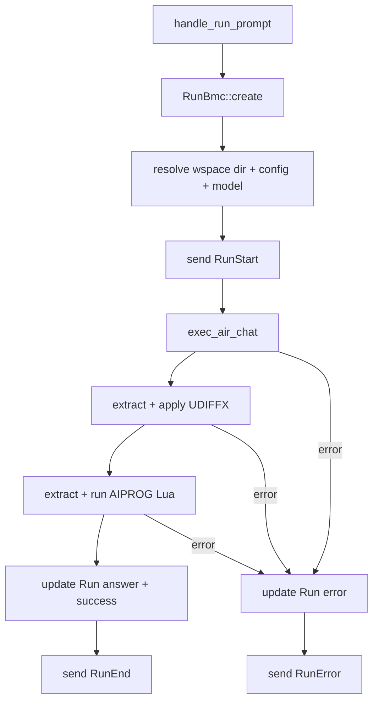
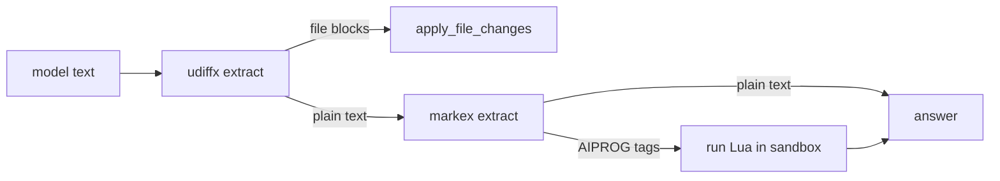

# 05 -- Executor

The executor turns a prompt into a completed run. It is a single task with one loop. It
creates a `Run`, asks the model for text, applies file changes and Lua scripts from that
text, and records the cost. This document follows one prompt end to end.

## The Problem It Solves

The model does not return a structured answer. It returns text. That text may embed unified
diffs to change files, and Lua scripts inside `<AIPROG>` tags to read or act on the
workspace. Someone has to create the records, call the model, interpret the text, apply the
side effects, and store the result. That someone is the executor.

The executor is a single writer. It owns the only path that runs model calls and mutates
state. This is deliberate.

```rust
// crates/zc-base/src/exec/executor.rs:12
pub struct Executor {
    action_rx: ExecCmdRx,
    inner: ExecutorInner,
}
```

The run loop is serial by construction.

```rust
// crates/zc-base/src/exec/executor.rs:112
pub async fn start(self) -> Result<()> {
    let Self { mut action_rx, inner } = self;
    let mm = get_model_manager()?;
    while let Ok(action) = action_rx.recv().await {
        let ExecReq { wspace_id, cmd } = action;
        match cmd {
            ExecCmd::RunPrompt(prompt) => {
                let _ = inner.handle_run_prompt(mm, wspace_id, prompt).await;
            }
        }
    }
    Ok(())
}
```

One task receives every `ExecReq` and handles it fully before the next. No two runs execute
at once. That removes an entire class of race conditions: the `air_idx_seq` counter, the
`total_cost` aggregate, and the in-memory database are all touched by one task only. The
"parallel first" claim in [00-overview.md](./00-overview.md) is about many clients and many
runs in flight, not about concurrent model calls inside one run.

## Construction: What the Executor Holds

`Executor::new` assembles the pieces. It opens two channels, syncs assets, loads config, and
builds the model's system prompt.

```rust
// crates/zc-base/src/exec/executor.rs:74
pub fn new(config: ExecutorConfig) -> Result<(Self, ExecCmdTx, ExecEventRx)> {
    let (action_tx, action_rx) = new_mpsc_bounded::<ExecReq>("executor_channel", 1000)?;
    let (status_tx, status_rx) = new_mpsc_bounded::<ExecEvent>("executor_channel", 1000)?;

    let zbase_dir = match &config.zbase_dir {
        Some(zbase_dir) => zbase_dir.clone(),
        None => zc_common::dirs::zbase_dir()?,
    };
    zc_asset::update_zbase_assets(&zbase_dir)?;
    let config_manager = ConfigManager::from_zbase_dir(zbase_dir)?;

    let aip_registry = aiprog::AipRegistry::from_aip_modules()?;
    let script_engine = aiprog::ScriptEngine::builder().with_registry(aip_registry).build()?;

    let system_prompt = prompts::maestro_entry_system(&script_engine)?;
    let base_chat_req = ChatRequest::from_system(system_prompt);

    Ok((Self { action_rx, inner: ExecutorInner { status_tx, genai_client: genai::Client::new()?, base_chat_req, wspace_dir: config.wspace_dir, base_dir: config.base_dir, model: config.model, config_manager, script_engine } }, action_tx, status_rx))
}
```

Three things stand out. The two channels are both named `"executor_channel"` and both
bounded to 1000. One carries commands in; the other carries lifecycle events out. The config
manager is loaded from the base directory, layering `config-default.toml` over
`config-user.toml` as [03-config-system.md](./03-config-system.md) describes. The system
prompt is built once from the udiffx file-change instructions and the aiprog Lua API docs,
then reused as the base for every request.

`ExecutorInner` holds the state the loop needs.

```rust
// crates/zc-base/src/exec/executor.rs:17
struct ExecutorInner {
    status_tx: ExecEventTx,
    genai_client: genai::Client,
    base_chat_req: ChatRequest,
    wspace_dir: SPath,
    base_dir: Option<SPath>,
    model: Option<String>,
    config_manager: ConfigManager,
    script_engine: aiprog::ScriptEngine,
}
```

## The RunPrompt Flow

`handle_run_prompt` is the core. It resolves everything dynamically, then runs the model
call in an async block so the error handling can be uniform.



The record is created first, before any model call.

```rust
// crates/zc-base/src/exec/executor.rs:132
let run_c = RunForCreate {
    wspace_id: Some(wspace_id),
    prompt: Some(prompt.clone()),
    answer: None,
};
let run_id = RunBmc::create(mm, run_c).await?;
```

Creating the `Run` first means an error is always attributable to a run. The `RunStart`
event and the `RunError` event both carry the same id. A crashed prompt still leaves a
`Run` row with an `error` and an `end_state`.

Then the executor resolves the workspace directory, the config, and the model.

```rust
// crates/zc-base/src/exec/executor.rs:159
let active_config = self.config_manager
    .resolve_for_wspace(mm, Some(wspace_id)).await
    .unwrap_or_else(|e| { tracing::warn!("..."); self.config_manager.get_config() });

let model_ref = self.model.as_deref().unwrap_or(active_config.maestro_model());
let resolved_model = active_config.get_model(model_ref)?;
```

The model reference comes from the explicit `--model` override if set, otherwise from the
config's `maestro_model` (default `$small`). The reference is then run through `get_model`
to resolve size presets and aliases. The result is the real model name handed to `genai`.

## The Air Request

The model call itself is wrapped by `exec_air_chat`, which records the request, the timing,
the tokens, and the cost on an `Air` row.

```rust
// crates/zc-base/src/exec/air_exec/runner.rs:8
pub async fn exec_air_chat(
    mm: &'static ModelManager,
    client: &genai::Client,
    model: &str,
    chat_req: ChatRequest,
    run_id: Id,
    wspace_id: Option<Id>,
    label: Option<&str>,
) -> Result<(ChatResponse, Id)> {
    let start = EpochUs::now();
    let air_c = prep_air_for_create(run_id, wspace_id, Some(model), &chat_req, start, label);
    let air_id = AirBmc::create_next(mm, run_id, air_c).await?;

    let ai_start = EpochUs::now();
    let options = ChatOptions::default().with_capture_raw_body(true);
    let chat_res = match client.exec_chat(model, chat_req, Some(&options)).await {
        Ok(res) => {
            let ai_end = EpochUs::now();
            let end = ai_end;
            let air_u = prep_air_for_success(&res, Some(ai_start), Some(ai_end), Some(end));
            let _ = AirBmc::update(mm, air_id, air_u).await;
            let _ = RunBmc::recompute_total_cost(mm, run_id).await;
            res
        }
        Err(err) => {
            let ai_end = EpochUs::now();
            let air_u = prep_air_for_error(err.to_string(), ai_end);
            let _ = AirBmc::update(mm, air_id, air_u).await;
            return Err(err.into());
        }
    };
    Ok((chat_res, air_id))
}
```

The timing is worth spelling out. `start` is recorded before the `Air` row is created.
`ai_start` is recorded right before `exec_chat`. `ai_end` is recorded right after. `end` is
set to `ai_end`. So the four timestamps on the `Air` row from
[02-domain-model.md](./02-domain-model.md) tell you: when the request was created, when the
model call began, when it returned, and when the record was finalized. The gap between
`start` and `ai_start` is bookkeeping overhead. The gap between `ai_start` and `ai_end` is
model latency.

`prep_air_for_success` fills the row with the provider's answer, usage, and cost.

```rust
// crates/zc-base/src/exec/air_exec/runner.rs:82
pub fn prep_air_for_success(res: &ChatResponse, ai_start: Option<EpochUs>, ai_end: Option<EpochUs>, end: Option<EpochUs>) -> AirForUpdate {
    let model_upstream = Some(res.provider_model_iden.model_name.to_string());
    let answer_json = serde_json::to_string(&res.content).ok();
    let usage_json = serde_json::to_string(&res.usage).ok();
    let ExtractedUsage { token_in, token_out, token_reason, token_cache_hit, token_cache_write } =
        extract_usage_metrics(&res.usage);
    let cost = price_it(
        res.provider_model_iden.adapter_kind.as_lower_str(),
        &res.provider_model_iden.model_name,
        &res.usage,
    ).map(|p| p.cost);
    AirForUpdate { model_upstream, answer_json, usage_json, token_in, token_out, token_reason, token_cache_hit, token_cache_write, cost, end_state: Some(AirEndState::Success.to_string()), ai_start, ai_end, end, ..Default::default() }
}
```

`model_upstream` is the model name the provider actually saw, distinct from the `model_ov`
the user requested. For an alias like `$small` resolving to `gpt-6-luna`, `model_ov` is
`$small` and `model_upstream` is `gpt-6-luna`.

### Usage Extraction

`extract_usage_metrics` maps `genai`'s nested usage struct to flat columns.

```rust
// crates/zc-base/src/exec/air_exec/usage.rs:23
pub fn extract_usage_metrics(usage: &Usage) -> ExtractedUsage {
    let token_in = usage.prompt_tokens.map(i64::from);
    let token_out = usage.completion_tokens.map(i64::from);
    let token_reason = usage.completion_tokens_details.as_ref().and_then(|d| d.reasoning_tokens).map(i64::from);
    let token_cache_hit = usage.prompt_tokens_details.as_ref().and_then(|d| d.cached_tokens).map(i64::from);
    let token_cache_write = None;
    ExtractedUsage { token_in, token_out, token_reason, token_cache_hit, token_cache_write }
}
```

Five metrics become columns. `token_in` is prompt tokens. `token_out` is completion tokens.
`token_reason` is the reasoning tokens inside the completion. `token_cache_hit` is cached
prompt tokens. `token_cache_write` is always `None` today — the provider usage struct has the
data, but the mapping is not yet wired. The five fields are separate so a future change only
touches this one function.

### Pricing

`price_it` calls the `aicost` crate, which holds per-model prices.

```rust
// crates/zc-base/src/exec/air_exec/pricing/pricer.rs:6
pub fn price_it(provider_type: &str, model_name: &str, usage: &Usage) -> Option<AiPrice> {
    let ai_cost = aicost::compute(provider_type, model_name, usage)
        .or_else(|_| aicost::compute(&provider_type.to_lowercase(), model_name, usage))
        .ok();
    let ai_cost = ai_cost?;
    Some(AiPrice {
        cost: ai_cost.total,
        cost_cache_write: (ai_cost.input_cache_write > 0.0).then_some(ai_cost.input_cache_write),
        cost_cache_saving: (ai_cost.input_cache_saving != 0.0).then_some(ai_cost.input_cache_saving),
    })
}
```

The provider type is tried as-is, then lowercased. This handles the `genai` adapter kind
"OpenAI" vs the `aicost` key "openai". The cost is stored as the single `total` value; the
cache write and cache saving costs are also captured as `Option`s. Only `cost` is persisted
on the `Air` row today, and it feeds `RunBmc::recompute_total_cost`, documented in
[04-persistence.md](./04-persistence.md).

## The Side-Effect Pipeline

After the model returns, the executor interprets the text. Two kinds of side effect are
possible: unified diffs and Lua scripts.

```rust
// crates/zc-base/src/exec/executor.rs:222
let (file_changes, other_content) = udiffx::extract_file_changes(&ai_response, true)?;
let _change_statuses = udiffx::apply_file_changes(&base_dir, file_changes, None)?;
let raw_answer = other_content.unwrap_or_default();

let (aiprog_scripts, mut answer) = extract_aiprog_scripts(&raw_answer);
for lua_script in aiprog_scripts {
    let mut running_context = aiprog::RunningContext::default();
    if let Ok(dir_ctx) = create_dir_context(&base_dir) {
        running_context.insert(dir_ctx);
    }
    running_context.insert(
        aiprog::AiContext::default()
            .with_genai_client(genai_client.clone())
            .with_default_model(resolved_model.clone()),
    );
    let outcome_text = run_lua_script(&script_engine, &lua_script, running_context).await?;
    if !answer.trim().is_empty() { answer.push_str("\n\n"); }
    answer.push_str(&outcome_text);
}
```

`udiffx::extract_file_changes` scans the model output for UDIFFX-format file blocks and
splits them from the plain text. `apply_file_changes` writes the files under `base_dir`. The
remaining text becomes `raw_answer`.

`extract_aiprog_scripts` uses `markex` to find `<AIPROG>...</AIPROG>` tags. Each tag body is
a Lua script. The executor runs each script with a `RunningContext` that carries two
capabilities: a `DirContext` (file read/write, restricted to `base_dir` by a `PathPolicy`)
and an `AiContext` (nested model calls, using the same resolved model). The script's return
value becomes the answer text. This is how the model asks for tool access: it emits Lua, the
executor runs it in a sandbox, and the result replaces the tag.



The answer is finally stored on the `Run` with `end_state: success`, and `RunEnd` is sent.

```rust
// crates/zc-base/src/exec/executor.rs:253
let end_time = EpochUs::now();
RunBmc::update(mm, run_id, RunForUpdate {
    answer: Some(answer.clone()),
    end: Some(end_time),
    end_state: Some(RunEndState::Success.to_string()),
    ..Default::default()
}).await?;
let _ = status_tx.send(ExecEvent::RunEnd(run_id)).await;
```

## The Error Path

The whole model-plus-side-effects block runs inside a `Result`-typed async block. Any error
from any stage falls through to one handler.

```rust
// crates/zc-base/src/exec/executor.rs:274
if let Err(err) = block_result {
    let end_time = EpochUs::now();
    RunBmc::update(mm, run_id, RunForUpdate {
        error: Some(err.to_string()),
        end: Some(end_time),
        end_state: Some(RunEndState::Error.to_string()),
        ..Default::default()
    }).await?;
    let _ = self.status_tx.send(ExecEvent::RunError(run_id)).await;
    return Err(err);
}
```

The run is marked with the error message, `end_state: error`, and `RunError` is sent. The
`Air` row was already marked `error` inside `exec_air_chat`, so both levels of the hierarchy
agree. The error is also returned from `handle_run_prompt`, but the `start` loop ignores the
return, so a failed run does not stop the executor.

## The Lua Sandbox Detail

`create_dir_context` shows the sandbox policy in one line.

```rust
// crates/zc-base/src/exec/executor.rs:318
fn create_dir_context(base_dir: &SPath) -> Result<aiprog::DirContext> {
    let _ = simple_fs::ensure_dir(base_dir);
    (|| {
        let base_dir_str = base_dir.as_str();
        let read_policy = aiprog::PathPolicy::new([base_dir_str], aiprog::AbsolutePathPolicy::Allow)?;
        let write_policy = aiprog::PathPolicy::new([base_dir_str], aiprog::AbsolutePathPolicy::Allow)?;
        aiprog::DirContext::new(base_dir_str, read_policy, write_policy)
    })().map_err(super::Error::custom_from_err)
}
```

The Lua scripts can read and write only under `base_dir`. The read and write policies are
separate, so a future hardening could allow reading broadly but writing narrowly. This is
the sandbox that makes `<AIPROG>` safe enough to run arbitrary model-authored Lua.

## The Aha Moment

**Aha:** The executor is an interpreter, not a caller. Most coding agents think of the model
as a function that returns an answer. zcoder treats the model's output as a program: it
contains UDIFFX blocks to change files and `<AIPROG>` Lua to run tools. The executor
*parses* that program and executes its two side-effect kinds, then stores what remains as
the answer. The model is not just asked a question — it is given a tiny two-instruction
language (change files, run Lua) and the executor is the runtime for it. This is why the
system prompt embeds both the udiffx and aiprog documentation: the prompt is teaching the
model the language the runtime understands.

## Where This Is Headed

The executor writes through the BMC layer in [04-persistence.md](./04-persistence.md) and
reads config through [03-config-system.md](./03-config-system.md). The events it emits travel
through the router to the TUI, described in [06-router-transport.md](./06-router-transport.md)
and [11-data-flow.md](./11-data-flow.md). The Lua sandbox and the in-memory database are
revisited for production hardening in [12-cross-cutting.md](./12-cross-cutting.md).
