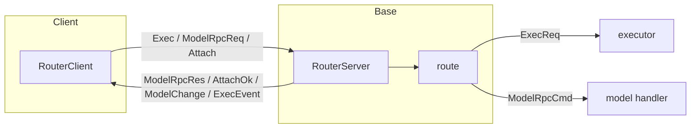
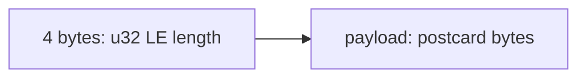
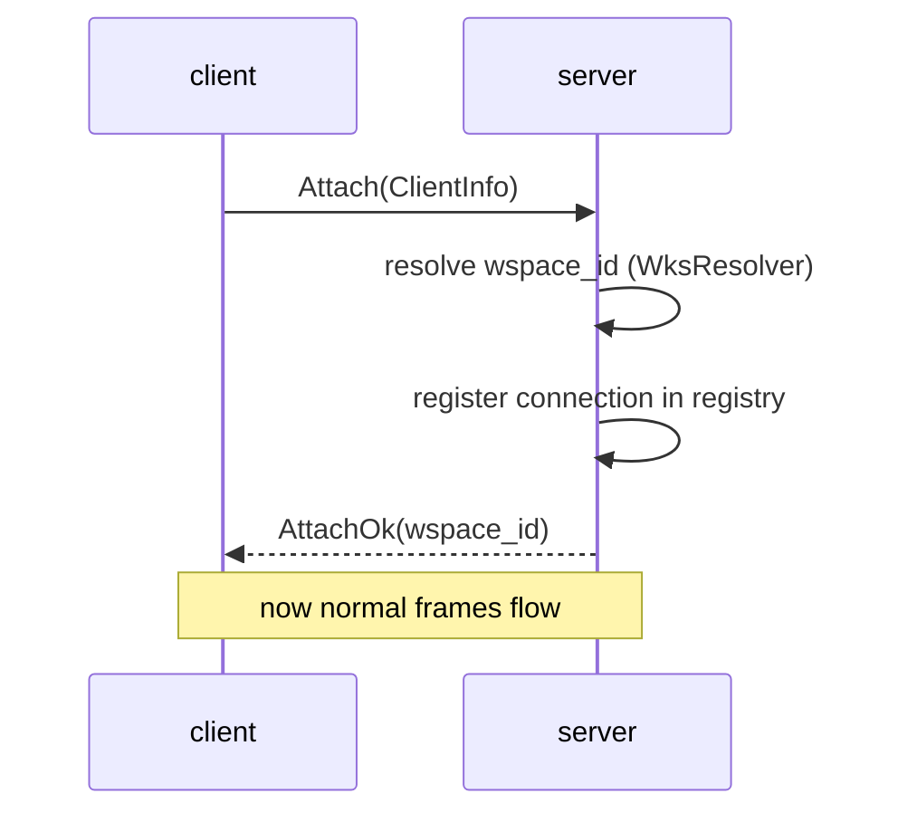

# 06 -- Router and Transport

The router is the boundary between the client and the daemon. It defines one message
envelope, one wire framing, one server, and one client. Every prompt, reply, and event
crosses this layer. This document opens the envelope, the frames, and the two endpoints.

## The Problem It Solves

Two processes need to talk, but they should not know each other's internals. The TUI should
not know the daemon uses SQLite. The daemon should not know the TUI uses a terminal grid.
They agree on one thing: a message format. The router is that agreement.

The message is an envelope with three fields.

```rust
// crates/zc-router/src/msg.rs:15
pub struct RouterMsg {
    pub msg_id: MsgId,
    pub wspace_id: Id,
    pub data: RouterMsgData,
}
```

`msg_id` correlates a reply with its request. `wspace_id` scopes a message to one workspace.
`data` is the payload. The payload is one of eight variants, and they are not all the same
kind of thing.

```rust
// crates/zc-router/src/msg.rs:24
pub enum RouterMsgData {
    ModelRpcReq(ModelRpcReq),
    ModelRpcRes(ModelRpcReply),
    ModelChange(ModelChangeEvent),
    Exec(ExecCmd),
    ExecEvent(ExecEvent),
    Attach(ClientInfo),
    AttachOk(Id),
    AttachErr(String),
}
```

The comment on the enum says it plainly: "The variants are intentionally not all the same
semantic kind." Some are requests (`ModelRpcReq`, `Exec`, `Attach`). Some are replies
(`ModelRpcRes`, `AttachOk`, `AttachErr`). Some are one-way notifications (`ModelChange`,
`ExecEvent`). One envelope carries all of them, and the router dispatches each by its
variant.



## Message Ids

Every message gets a fresh id from a process-local counter.

```rust
// crates/zc-router/src/msg.rs:40
static NEXT_MSG_ID: AtomicU64 = AtomicU64::new(1);

impl RouterMsg {
    pub fn new(data: RouterMsgData) -> Self {
        let msg_id = MsgId::new(NEXT_MSG_ID.fetch_add(1, Ordering::Relaxed));
        Self { msg_id, wspace_id: Id::default(), data }
    }
}
```

The id starts at 1 and increments by 1 for each message in the process. `Ordering::Relaxed`
is enough because the counter only needs to be unique, not ordered against other memory. The
id is the key the client uses to match a `ModelRpcRes` back to the `ModelRpcReq` that asked
for it.

## The Wire Framing

Messages cross the Unix socket as postcard bytes inside a length-delimited frame.

```rust
// crates/zc-router/src/transport/wire.rs:15
pub const MAX_FRAME_LEN: u32 = 8 * 1024 * 1024;
```

A frame is a 4-byte little-endian unsigned length, then that many payload bytes.



The codec is configured with `tokio_util`'s `LengthDelimitedCodec`.

```rust
// crates/zc-router/src/transport/wire.rs:34
fn new_codec() -> LengthDelimitedCodec {
    LengthDelimitedCodec::builder()
        .length_field_type::<u32>()
        .length_field_offset(0)
        .little_endian()
        .length_adjustment(0)
        .num_skip(4)
        .max_frame_length(MAX_FRAME_LEN as usize)
        .new_codec()
}
```

Four bytes of length. Little-endian, so the least significant byte comes first. `num_skip(4)`
tells the codec the length field itself is four bytes, so the payload starts after them.
`max_frame_length(8 MiB)` is the guard: a bogus length prefix cannot make the reader allocate
unbounded memory.

The writer serializes then sends, refusing anything over the limit.

```rust
// crates/zc-router/src/transport/wire.rs:101
pub(crate) async fn write_frame(&mut self, value: &T) -> Result<()> {
    let payload = postcard::to_stdvec(value)?;
    if payload.len() > MAX_FRAME_LEN as usize {
        return Err(Error::FrameTooLarge { len: payload.len(), max: MAX_FRAME_LEN });
    }
    self.framed.send(Bytes::from(payload)).await?;
    SinkExt::<Bytes>::flush(&mut self.framed).await?;
    Ok(())
}
```

The reader returns `Ok(None)` on a clean end of stream, so a peer closing on a frame
boundary is not an error.

```rust
// crates/zc-router/src/transport/wire.rs:70
pub(crate) async fn read_frame(&mut self) -> Result<Option<T>> {
    match self.framed.next().await {
        Some(Ok(payload)) => Ok(Some(postcard::from_bytes(&payload)?)),
        Some(Err(err)) => Err(err.into()),
        None => Ok(None),
    }
}
```

postcard is chosen because it is small and deterministic — the same bytes come back on both
ends. It has no versioning or self-description, which is fine because both ends run the same
binary.

## The Server

`RouterServer::bind` owns the socket. It refuses to start if a live server already answers
on the path.

```rust
// crates/zc-router/src/server.rs:58
pub async fn bind(socket_path: impl AsRef<Path>, exec_cmd_tx: ExecCmdTx, model_rpc_cmd_tx: ModelRpcCmdTx, wspace_resolver: Arc<dyn WksResolver>, model_change_rx: ModelChangeRx, exec_event_rx: ExecEventRx) -> Result<Self> {
    let socket_path = socket_path.as_ref();
    if is_live(socket_path).await {
        return Err(Error::custom(format!("a live server already owns the socket path {}", socket_path.display())));
    }
    unlink_if_exists(socket_path)?;
    let listener = UnixListener::bind(socket_path)?;
    let (registry, conn_watch) = ConnRegistry::new();
    Ok(Self { listener, exec_cmd_tx, model_rpc_cmd_tx, wspace_resolver, model_change_rx, exec_event_rx, registry, conn_watch })
}
```

The `is_live` check is important on Unix. A stale socket file from a crashed server would
otherwise make `bind` fail with "address in use". zcoder instead connects to check for a
live server, unlinks a stale path, and binds.

`run` starts two fan-out loops and an accept loop.

```rust
// crates/zc-router/src/server.rs:99
pub async fn run(self) -> Result<()> {
    let Self { listener, exec_cmd_tx, model_rpc_cmd_tx, wspace_resolver, model_change_rx, exec_event_rx, registry, .. } = self;
    tokio::spawn(run_model_change_fanout(model_change_rx, registry.clone()));
    tokio::spawn(run_exec_event_fanout(exec_event_rx, registry.clone()));
    loop {
        let (stream, _addr) = listener.accept().await?;
        // ... clone handles ...
        tokio::spawn(async move {
            if let Err(err) = handle_conn(stream, exec_cmd_tx, model_rpc_cmd_tx, wspace_resolver, registry).await {
                tracing::error!("->> service connection error: {err}");
            }
        });
    }
}
```

One task per connection. The two fan-out loops read the base's outbound event channels and
broadcast to every matching connection.

### The Attach Handshake

A connection does not start sending commands immediately. It first sends an `Attach` frame
announcing its workspace. The server resolves that to a workspace id, registers the
connection, and replies `AttachOk`.



The relevant code is the inline handshake in `handle_conn`.

```rust
// crates/zc-router/src/server.rs:186
let Some(first) = reader.read_frame().await? else {
    drop(res_tx); let _ = writer_task.await; return Ok(());
};
let RouterMsgData::Attach(info) = first.data else {
    tracing::error!("->> first frame is not an attach, closing connection");
    drop(res_tx); let _ = writer_task.await; return Ok(());
};
let wspace_id = match wspace_resolver.resolve(&info).await {
    Ok(wspace_id) => wspace_id,
    Err(err) => {
        let reply = RouterMsg { msg_id: first.msg_id, wspace_id: Id::default(), data: RouterMsgData::AttachErr(err.reason()) };
        let _ = res_tx.send(reply).await;
        drop(res_tx); let _ = writer_task.await; return Ok(());
    }
};
let conn_guard = ConnGuard { registry: registry.clone(), conn_id: registry.register(wspace_id, info, res_tx.clone()) };
let ack = RouterMsg { msg_id: first.msg_id, wspace_id, data: RouterMsgData::AttachOk(wspace_id) };
let _ = res_tx.send(ack).await;
```

If the first frame is not an `Attach`, the connection is closed. If resolution fails, an
`AttachErr` with the reason is sent and the connection closed. Only after a successful
attach does the normal read loop begin.

### The Connection Registry

The registry maps connection ids to their workspace and response sender.

```rust
// crates/zc-router/src/server.rs:269
struct ConnRegistry {
    inner: Arc<Mutex<ConnRegistryInner>>,
}
struct ConnRegistryInner {
    next_id: ConnId,
    conns: HashMap<ConnId, ConnEntry>,
    conn_count_tx: watch::Sender<usize>,
}
```

Broadcast fans an event out to every connection that passes `client_filter`.

```rust
// crates/zc-router/src/server.rs:327
async fn broadcast(&self, msg: RouterMsg) {
    let targets: Vec<RouterMsgTx> = {
        let inner = self.inner.lock().unwrap_or_else(|err| err.into_inner());
        inner.conns.values().filter(|entry| client_filter(entry.wspace_id, &msg)).map(|entry| entry.res_tx.clone()).collect()
    };
    for res_tx in targets {
        if let Err(err) = res_tx.send(msg.clone()).await {
            tracing::warn!("->> failed to deliver event to a connection: {err}");
        }
    }
}
```

`client_filter` is the single home for fan-out policy.

```rust
// crates/zc-router/src/client_filter.rs:16
pub fn client_filter(client_wspace_id: Id, msg: &RouterMsg) -> bool {
    msg.wspace_id == client_wspace_id || msg.wspace_id == Id::default()
}
```

A message whose `wspace_id` matches the client is delivered. A message with the default nil
UUID is unscoped and delivered to everyone. Anything else belongs to another workspace and
is dropped. One field is both the routing key and the broadcast flag.

## The Client

`RouterClient` is the frontend's handle. It has two transports: in-process for the same
binary, and Unix-socket for the split client/daemon case.

```rust
// crates/zc-router/src/client.rs:38
pub(crate) enum Outbound {
    InProc(RouterMsgTx),
    #[cfg(feature = "client")]
    Uds(ClientConn),
}
```

`send` stamps the workspace id when a caller left it default.

```rust
// crates/zc-router/src/client.rs:162
pub async fn send(&self, mut msg: RouterMsg) -> Result<()> {
    if msg.wspace_id == Id::default()
        && let Some(wspace_id) = self.wspace_id()
    {
        msg.wspace_id = wspace_id;
    }
    match &self.inner.outbound {
        Outbound::InProc(tx) => tx.send(msg).await.map_err(Into::into),
        #[cfg(feature = "client")]
        Outbound::Uds(conn) => conn.send(msg).await,
    }
}
```

The client owns its workspace id after attach. A caller that does not set a scope gets the
client's own workspace id filled in. This is why `RouterMsg::new` defaults `wspace_id` to
nil: the default means "the caller did not care, use my workspace".

### The Model RPC Correlation

The client's request/reply mechanism avoids a reverse channel. Each request carries a
single-use `OnceTx`, and a map tracks pending ids.

```rust
// crates/zc-router/src/client.rs:44
type PendingReplyMap = HashMap<MsgId, OnceTx<ModelRpcReply>>;
```

`request` registers the reply handle under the message id, then sends.

```rust
// crates/zc-router/src/model_rpc.rs:268
async fn request(client: &RouterClient, req: ModelRpcReq, res_tx: OnceTx<ModelRpcReply>, res_rx: OnceRx<ModelRpcReply>) -> ModelRpcResult<ModelRpcReply> {
    let msg = RouterMsg::new(RouterMsgData::ModelRpcReq(req));
    let msg_id = msg.msg_id;
    client.register_pending(msg_id, res_tx)?;
    let _pending = PendingRequest { client, msg_id };
    if let Err(err) = client.send(msg).await { return Err(ModelRpcError::custom(err.to_string())); }
    res_rx.recv().await.map_err(|err| ModelRpcError::custom(err.to_string()))
}
```

The `PendingRequest` guard is the subtle part. When it drops — including when the caller is
cancelled mid-await — its `Drop` impl removes the pending entry.

```rust
// crates/zc-router/src/model_rpc.rs:261
impl Drop for PendingRequest<'_> {
    fn drop(&mut self) {
        self.client.remove_pending(self.msg_id);
    }
}
```

This is why the cancelled-request test passes: a task that aborts while awaiting a reply
does not leak a stale entry in the pending map. The reply side completes the pending entry
via `complete_pending`, which removes the `OnceTx` and sends the reply into it.

The request and reply are split into wire-safe and in-process forms. `ModelRpcReq` has no
channel handles, so it serializes. `ModelRpcCmd` carries the live `OnceTx`, so it stays
behind the client facade.

```rust
// crates/zc-router/src/model_rpc.rs:13
pub enum ModelRpcReq {
    RunGet { id: Id },
    RunList { options: ListRunOptions },
    AirGet { id: Id },
    AirList { options: ListAirOptions },
    DbSize,
}
```

Five read operations. Four read runs or airs; one reads the database size. There is no
write RPC — writes go through the executor's `Exec` command, which is one-way.

### ListOptions Over the Wire

`ListOptions` does not serialize cleanly, so `model_rpc.rs` defines a custom serde shim.
The `order_bys` field is a struct in memory but a string on the wire.

```rust
// crates/zc-router/src/model_rpc.rs:194
#[derive(Serialize, Deserialize)]
struct ListOptionsDef {
    offset: Option<i64>,
    limit: Option<i64>,
    order_bys: Option<String>,
}
```

The serializer formats the order-bys debug representation into a `"column direction"`
string, and the deserializer parses it back. This is a small, contained shim: the wire
format is flat, the in-memory format is typed, and one module bridges them.

## The Aha Moment

**Aha:** The `RouterMsgData` enum deliberately mixes requests, replies, and notifications in
one variant set, and the router treats each variant by its *semantic kind*, not by a
direction field. There is no `kind: Request | Reply | Event` discriminator. The variant
itself is the kind. `ModelRpcReq` is a request, so `route` awaits a reply. `ModelChange` is
a notification, so `route` just logs it and moves on. This is the opposite of the
"everything is a request/response" designs common in RPC frameworks. It means adding a new
one-way event is one enum variant plus one match arm, not a new channel, a new correlation
map, and a new reverse path.

## Where This Is Headed

The wire framing is consumed by the bootstrap in [10-bootstrap-lifecycle.md](./10-bootstrap-lifecycle.md),
which binds the socket and runs the accept loop. The events that fan out here originate in
[05-executor.md](./05-executor.md) and [04-persistence.md](./04-persistence.md). The TUI
receives them as the streams described in [08-tui-core.md](./08-tui-core.md). The full
round trip is traced in [11-data-flow.md](./11-data-flow.md).
