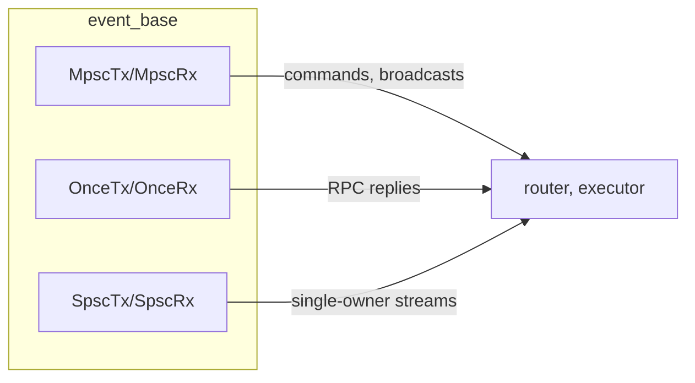

# 07 -- Event Infrastructure

`zc-common` is the foundation crate. It depends on nothing else in the workspace, and
everything else depends on it. It holds the channel facade, time helpers, path helpers,
cache, clipboard, and JSON/YAML glue. This document opens each piece.

## The Problem It Solves

Every layer above `zc-common` needs the same plumbing: bounded channels, timestamps, paths,
a debug cache, and a clipboard. If each layer wrote its own, the channel semantics would
drift and the paths would disagree. `zc-common` provides one version of each, and the rest of
the workspace builds on it.

The crate is small and honest. Its `lib.rs` lists the modules.

```rust
// crates/zc-common/src/lib.rs:3
mod error;
mod msg_id;
pub use error::{Error, Result};
pub use msg_id::MsgId;
pub mod cache;
pub mod clipboard;
pub mod consts;
pub mod dirs;
pub mod event_base;
pub mod jsons;
pub mod time;
pub mod yaml;
```

## The Channel Facade

The most important module is `event_base`. It wraps the `crossfire` channel library behind a
small, named facade.

```rust
// crates/zc-common/src/event_base/mod.rs:1
//! Application-owned channel facade over Crossfire.
//!
//! This layer exposes named, bounded MPSC, MPMC, SPSC, synchronous SPSC, and
//! one-shot channels without leaking Crossfire endpoint types.
```

Three channel kinds are exposed. MPSC (multi-producer, single-consumer) is the workhorse.
SPSC (single-producer, single-consumer) is for one-owner streams. One-shot carries a single
value.

```rust
// crates/zc-common/src/event_base/common.rs:1
pub const DEFAULT_CAPACITY: usize = 1000;
```

The default capacity is 1000. Every bounded channel created without an explicit capacity
uses this. The router message channel, the model change channel, the exec event channel, and
the executor's two channels all use it directly or indirectly. The number is a tuning
choice: large enough to absorb bursts, small enough to apply backpressure.

A channel is created with a name, kept for diagnostics.

```rust
// crates/zc-common/src/event_base/event_mpsc.rs:24
pub fn new_mpsc_bounded<T>(name: &'static str, capacity: usize) -> EventBaseResult<(MpscTx<T>, MpscRx<T>)>
where
    T: Send + 'static,
{
    if capacity == 0 {
        return Err(EventBaseError::InvalidCapacity { name, capacity });
    }
    let (tx, rx) = mpsc::bounded_async::<T>(capacity);
    Ok((MpscTx { inner: tx, name }, MpscRx { inner: rx, name }))
}
```

The `name` is a `&'static str` retained by both endpoints. When a send fails because the
receiver disconnected, the error carries the name, so a log line reads "channel
`executor_channel` receiver disconnected" instead of a bare number. That is the whole point
of the facade: crossfire gives raw channels, and `event_base` adds names and a uniform
disconnection error.

The disconnection error is one enum.

```rust
// crates/zc-common/src/event_base/event_base_error.rs:14
#[non_exhaustive]
pub enum EventBaseError {
    InvalidCapacity { name: &'static str, capacity: usize },
    TxDisconnected { name: &'static str },
    RxDisconnected { name: &'static str },
}
```

`is_disconnected` treats both `TxDisconnected` and `RxDisconnected` as the normal shutdown
signal. When a peer drops, a loop can check `is_disconnected()` and exit cleanly rather than
treating a closed channel as a bug.

### The Three Channel Kinds

MPSC and SPSC share the same shape: a `send` that waits for capacity, a `try_send` that
returns the message back when full, and a `recv` that waits. The difference is ownership.
MPSC senders are `Clone`; SPSC senders are not, so a single-owner guarantee is enforced by
the type system.

```rust
// crates/zc-common/src/event_base/event_spsc.rs:40
pub struct SpscTx<T: Send + 'static> {
    pub(super) inner: AsyncTx<spsc::Array<T>>,
    pub(super) name: &'static str,
}
```

One-shot is simpler: it carries exactly one value.

```rust
// crates/zc-common/src/event_base/event_once.rs:13
pub fn new_once<T>(name: &'static str) -> (OnceTx<T>, OnceRx<T>) {
    let (tx, rx) = oneshot::oneshot();
    (OnceTx { inner: tx, name }, OnceRx { inner: rx, name })
}
```

`OnceTx::send` consumes the sender and delivers without a status, because the underlying
one-shot sender does not report a dropped receiver. `OnceRx::recv` returns
`RxDisconnected` if the sender drops first. This is the channel the router uses to correlate
an RPC reply with its request, as [06-router-transport.md](./06-router-transport.md) shows.

The channel kinds compose. An MPSC channel carries commands into the executor. A one-shot
carries a single reply back out. A SPSC channel would carry a stream with one clear owner.



## MsgId vs Id

`zc-common` defines `MsgId`, a protocol-level identity, and it is deliberately distinct from
the domain `Id` in `zc-core`.

```rust
// crates/zc-common/src/msg_id.rs:11
#[serde(transparent)]
pub struct MsgId(u64);
```

`MsgId` is a plain `u64`. It identifies a message in flight, not a persisted entity. The
`Id` type in [02-domain-model.md](./02-domain-model.md) is a UUID and identifies a database
row. Keeping the two separate prevents a programmer from passing a message id where an
entity id is required. The `#[serde(transparent)]` makes it serialize as a bare number.

## Constants and Paths

The shared constants live in `consts.rs`.

```rust
// crates/zc-common/src/consts.rs:7
pub const BASE_SOCK_PATH: &str = "/tmp/zcoder-base.sock";
pub const ZBASE_DIR_NAME: &str = "zcoder-base";
pub const ZCODER_BASE_DIR_ENV: &str = "ZCODER_BASE_DIR";
pub const CONFIG_DIR_NAME: &str = ".config";
pub const WKS_MARKER_DIR_NAME: &str = ".zcoder";
pub const DEBUG_LOG_DIR_NAME: &str = "debug-log";
pub const DEBUG_LOG_FILE_NAME: &str = "log.txt";
pub const BASE_IDLE_GRACE_SECS: u64 = 5;
```

These are the single source of truth for paths both processes must agree on. The socket
path is here, so the client and daemon can never spell it differently. The workspace marker
`.zcoder` is here, so directory discovery and config resolution agree on the same marker.
The idle grace period of 5 seconds is here, so the daemon's shutdown timer is a named
constant, not a magic number.

`dirs.rs` derives paths from these constants.

```rust
// crates/zc-common/src/dirs.rs:17
pub fn zbase_dir() -> Result<SPath> {
    match std::env::var(ZCODER_BASE_DIR_ENV) {
        Ok(value) => { /* resolve relative to cwd */ }
        Err(std::env::VarError::NotPresent) => {
            let home = home_dir().ok_or_else(|| Error::custom("HOME environment variable is not set"))?;
            Ok(zbase_dir_from_home(&home))
        }
        Err(_) => Err(/* not unicode */),
    }
}
```

The base directory is `$HOME/.config/zcoder-base` by default, overridable with the
`ZCODER_BASE_DIR` environment variable. The env override may be relative, in which case it is
resolved against the current directory. This lets a test or a per-project checkout point the
daemon at its own base directory.

The most interesting path helper is workspace discovery.

```rust
// crates/zc-common/src/dirs.rs:41
pub fn find_wspace_dir(from: &SPath) -> Option<SPath> {
    let mut current = Some(from.clone());
    while let Some(dir) = current {
        if dir.join(WKS_MARKER_DIR_NAME).is_dir() {
            return Some(dir);
        }
        current = dir.parent();
    }
    None
}
```

`find_wspace_dir` walks up from a directory until it finds a `.zcoder/` subdirectory. This is
how `zc` knows which workspace it is in when run from a nested subdirectory: it climbs to the
nearest ancestor that carries the marker. The marker is the same `.zcoder` directory that
holds the workspace config from [03-config-system.md](./03-config-system.md).

## Time

`time.rs` provides microseconds and RFC 3339 formatting.

```rust
// crates/zc-common/src/time.rs:30
pub fn now_micro() -> i64 {
    let now = SystemTime::now();
    let since_the_epoch = now.duration_since(UNIX_EPOCH).unwrap_or(Duration::new(0, 0));
    since_the_epoch.as_micros().min(i64::MAX as u128) as i64
}
```

`now_micro` is the timestamp used everywhere in the domain layer — `EpochUs::now()` in
[02-domain-model.md](./02-domain-model.md) and `prep_fields` in
[04-persistence.md](./04-persistence.md) both call a variant of it. It returns microseconds
since the Unix epoch, clamped to `i64::MAX`.

There are two precisions of RFC 3339 formatting: seconds and microseconds, each in local and
UTC forms. The microsecond format is used for the debug logs; the second format for
human-facing timestamps. A `today_local` and `today_utc` pair returns `YYYY-MM-DD`.

The `tick_count` family is a small bonus: it converts a timestamp into a number of whole
ticks, useful for periodic UI work without a timer.

```rust
// crates/zc-common/src/time.rs:94
pub fn tick_count(time_micro: i64, tick_seconds: f64) -> i64 {
    let safe_tick = if tick_seconds <= 0.0 { 0.1 } else { tick_seconds };
    let micros_per_tick = ((safe_tick * 1_000_000.0).round() as i64).max(1);
    (time_micro.max(0)) / micros_per_tick
}
```

## Cache

The cache writes files under `.zcoder/.cache`, used by the executor to dump raw request and
response payloads for debugging.

```rust
// crates/zc-common/src/cache.rs:5
pub const CACHE_DIR: &str = ".zcoder/.cache";

pub fn save_file_cache(file_path: impl AsRef<Path>, content: impl AsRef<[u8]>) -> Result<SPath> {
    let full_path = SPath::new(CACHE_DIR).join_std_path(file_path.as_ref())?;
    ensure_file_dir(&full_path)?;
    std::fs::write(full_path.as_std_path(), content.as_ref())?;
    Ok(full_path)
}
```

The executor calls this with names like `last-ai-01-request-system-prompt.md` and
`last-ai-02-response-raw.md`, so a developer can inspect the exact prompt and response that
went to and from the model. The path is relative to the current working directory, so the
cache lands inside the workspace being worked on.

## JSON Merge

The config system depends on `jsons::merge`, a recursive JSON deep-merge.

```rust
// crates/zc-common/src/jsons.rs:11
pub fn merge(base: Value, overlay: Value) -> Value {
    match (base, overlay) {
        (Value::Object(mut base_map), Value::Object(overlay_map)) => {
            for (key, overlay_val) in overlay_map {
                let merged_val = match base_map.remove(&key) {
                    Some(base_val) => merge(base_val, overlay_val),
                    None => overlay_val,
                };
                base_map.insert(key, merged_val);
            }
            Value::Object(base_map)
        }
        (_base, overlay) => overlay,
    }
}
```

Two rules. Objects merge recursively: a key in `overlay` overrides the same key in `base`,
and a key absent from `overlay` keeps its `base` value. Everything else — scalars, arrays,
null — is replaced outright by the `overlay` value. This is exactly the semantics the config
layering needs, documented in [03-config-system.md](./03-config-system.md).

## YAML and Clipboard

`yaml.rs` wraps `yaml_serde` for three operations: serialize to YAML, deserialize from YAML,
and the special `json_to_yaml_string`. The executor uses `json_to_yaml_string` to turn a Lua
script's non-string return value into a readable answer.

`clipboard.rs` wraps `arboard` with a deliberately kept-alive handle.

```rust
// crates/zc-common/src/clipboard.rs:7
#[derive(Default)]
pub struct Clipboard {
    inner: Option<arboard::Clipboard>,
}
```

The handle is created lazily on first use and kept for the process lifetime. The comment
explains why: on Linux, the process that set the clipboard content must stay alive to serve
it. A clipboard handle dropped too early would lose the content. The wrapper encodes that
platform-specific knowledge in one place.

## The Aha Moment

**Aha:** A channel's name is a first-class diagnostic, not a comment. Every channel in
`event_base` stores its `&'static str` name inside both endpoints, and every disconnection
error carries it. The result is that a failure deep inside the system reads
"channel `executor_channel` receiver disconnected" — you know *which* of the dozen channels
died, without attaching a debugger. The author traded one `&'static str` per channel for a
debuggable system, and every channel in the codebase pays it. This is the same discipline as
the entity/table naming in [02-domain-model.md](./02-domain-model.md): a small, uniform
cost that makes failures legible.

## Where This Is Headed

The channel facade is the substrate for the router streams in
[06-router-transport.md](./06-router-transport.md) and the executor channels in
[05-executor.md](./05-executor.md). The path and constant helpers drive the bootstrap in
[10-bootstrap-lifecycle.md](./10-bootstrap-lifecycle.md). The time helpers are consumed by
the domain layer in [02-domain-model.md](./02-domain-model.md).
