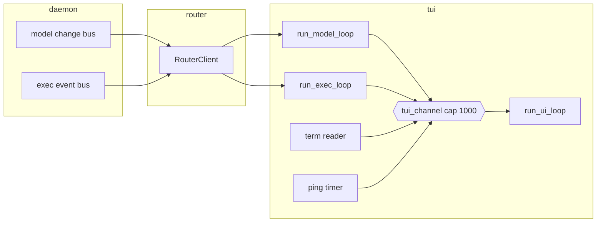
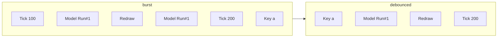

# 08 -- TUI Core

The TUI (terminal user interface) is the client half of `zc`. It turns keystrokes into
prompts, model events into screen updates, and a redraw into pixels. This document covers the
event loop, the debouncer, the state machine, and the prompt buffer. The rendering side is
[09-tui-rendering.md](./09-tui-rendering.md).

## The Problem It Solves

The daemon pushes a stream of model changes and exec events over the socket. The user pushes
a stream of keystrokes and mouse events. The screen must reflect both without flicker, without
a busy loop, and without redrawing more often than needed. The answer is a single event
channel, a debouncer that batches one frame, and a state machine that both streams update.

Every input and every daemon event funnels into one channel of one event type.

```rust
// crates/zc-tui/src/core/event.rs:11
#[derive(Debug, Clone)]
pub enum TuiEvent {
    Term(Event),
    Action(AppActionEvent),
    Exec(ExecEvent),
    Model(ModelChangeEvent),
    Tick(i64),
    #[allow(unused)]
    DoRedraw,
}
```

`Term` is a crossterm input event (key, mouse, paste). `Action` is an app-level command such
as quit or run a prompt. `Exec` is a run lifecycle event from the daemon. `Model` is a data
change event from the daemon. `Tick` is a timestamp that drives the elapsed-time clock.
`DoRedraw` asks for a repaint. Six variants, one channel.

`AppActionEvent` is deliberately tiny.

```rust
// crates/zc-tui/src/core/event.rs:22
#[derive(Debug, Clone)]
pub enum AppActionEvent {
    Quit,
    RunPrompt(String),
}
```

The terminal is too narrow to need more than "quit" and "run this text". A keystroke like
Ctrl+C does not quit directly; it enqueues `Action(Quit)`, and the loop decides. This keeps
input handling pure and lets the same action be triggered from anywhere.

## Startup: Wiring the Loops

`start_tui` is the assembly point. It sets up the terminal, creates the event channel, and
spawns every loop before entering the main one.

```rust
// crates/zc-tui/src/core/tui_impl.rs:9
pub async fn start_tui(client: RouterClient, initial_prompt: Option<String>) -> Result<()> {
    let (terminal, _term_setup) = TermSetup::init()?;

    let (tui_tx, tui_rx) = new_mpsc_bounded::<TuiEvent>("tui_channel", 1000)?;

    if let Some(model_change_rx) = client.take_model_change_rx() {
        let tui_tx_for_model = tui_tx.clone();
        tokio::spawn(async move { run_model_loop(tui_tx_for_model, model_change_rx).await });
    }
    if let Some(exec_event_rx) = client.take_exec_event_rx() {
        let tui_tx_for_exec = tui_tx.clone();
        tokio::spawn(async move { run_exec_loop(tui_tx_for_exec, exec_event_rx).await });
    }

    term_reader::run_term_reader(tui_tx.clone());
    let ping_tx = ping_timer::start_ping_timer(tui_tx.clone())?;

    let res = tui_loop::run_ui_loop(terminal, tui_rx, tui_tx, ping_tx, client, initial_prompt).await;
    res
}
```

Four producers feed the one channel. Two are the daemon forwarders (`run_model_loop`,
`run_exec_loop`). One is the terminal reader. One is the ping timer. The main loop is the
single consumer.

The two forwarders are near-identical. Each takes a router receiver, peels the relevant
variant, and re-sends it as a `TuiEvent`.

```rust
// crates/zc-tui/src/core/model_loop.rs:8
pub async fn run_model_loop(tui_tx: TuiTx, mut model_change_rx: ModelChangeRx) {
    while let Ok(msg) = model_change_rx.recv().await {
        let RouterMsgData::ModelChange(model_event) = msg.data else {
            continue;
        };
        let res = tui_tx.send(TuiEvent::Model(model_event)).await;
        if res.is_err() {
            break;
        }
    }
}
```

`run_exec_loop` is the same shape for `ExecEvent`. They exist only to translate a router
message into a TUI event. When the TUI channel's receiver drops, the `send` fails and the
forwarder exits, using the channel-disconnection signal from
[07-event-infrastructure.md](./07-event-infrastructure.md).



## The Main Loop

`run_ui_loop` is the heartbeat. It draws, waits for one event, drains and debounces the
burst, handles each event, then decides whether to ping.

```rust
// crates/zc-tui/src/core/tui_loop.rs:10
pub async fn run_ui_loop(
    mut terminal: DefaultTerminal,
    mut tui_rx: TuiRx,
    tui_tx: TuiTx,
    ping_tx: PingTimerTx,
    client: RouterClient,
    initial_prompt: Option<String>,
) -> Result<()> {
    let mut state = TuiState::new(initial_prompt);

    loop {
        terminal.draw(|f| view::render(f, &mut state))?;

        let app_event = tui_rx.recv().await?;
        let events = debounce_events(&mut tui_rx, app_event);

        let mut should_quit = false;
        for event in events {
            match handle_tui_event(&mut state, &tui_tx, &client, event).await {
                Ok(false) => (),
                Ok(true) => { should_quit = true; break; }
                Err(err) => { warn!("tui loop error on app_event. Cause: {err:?}"); should_quit = true; break; }
            }
        }

        if should_quit { break; }

        if state.should_be_pinged() {
            let _ = ping_tx.send(zc_common::time::now_micro()).await;
        }
    }
    Ok(())
}
```

The order matters. Draw first, then block on the next event, then drain everything already
queued behind it into one batch. That batch is handled before the next draw. The result is
one draw per batch of events, not one draw per event.

## The Debouncer

The debouncer is the subtle piece. A burst of events between two draws is reduced to the
smallest set that still conveys everything.

```rust
// crates/zc-tui/src/core/debouncer.rs:8
pub struct Debouncer {
    last_redraw_event: Option<TuiEvent>,
    ui_events: Vec<TuiEvent>,
    exec_events: Vec<TuiEvent>,
    event_by_key: HashMap<(EntityType, Option<Id>), TuiEvent>,
    tick_event: Option<TuiEvent>,
}
```

Each event kind is coalesced differently.

```rust
// crates/zc-tui/src/core/debouncer.rs:29
pub fn process(&mut self, app_event: TuiEvent) {
    match app_event {
        TuiEvent::DoRedraw => { self.last_redraw_event = Some(TuiEvent::DoRedraw); }
        TuiEvent::Term(event) => { self.ui_events.push(TuiEvent::Term(event)); }
        TuiEvent::Action(action_event) => { self.ui_events.push(TuiEvent::Action(action_event)); }
        TuiEvent::Exec(exec_event) => { self.exec_events.push(TuiEvent::Exec(exec_event)); }
        TuiEvent::Model(model_event) => {
            let key = (model_event.entity, model_event.id);
            self.event_by_key.insert(key, TuiEvent::Model(model_event));
        }
        TuiEvent::Tick(ts) => { self.tick_event = Some(TuiEvent::Tick(ts)); }
    }
}
```

Four rules. `DoRedraw` collapses to a single flag — ten redraw requests become one. `Term`
and `Action` are FIFO — order matters, so they are appended in order. `Exec` events are also
FIFO. `Model` events are deduplicated by `(entity, id)` — the latest update to the same row
wins, because the TUI will re-fetch the row anyway. `Tick` collapses to the newest timestamp —
only the latest clock reading matters.

The result ordering is deterministic: UI events, then exec events, then the deduplicated
model events, then the redraw, then the tick.



Three events for six. The duplicate model update and the older tick are gone.

`debounce_events` drains the channel without waiting.

```rust
// crates/zc-tui/src/core/debouncer.rs:67
pub fn debounce_events(tui_rx: &mut MpscRx<TuiEvent>, first_event: TuiEvent) -> Vec<TuiEvent> {
    let mut debouncer = Debouncer::new(first_event);
    loop {
        match tui_rx.try_recv() {
            Ok(Some(app_event)) => { debouncer.process(app_event); }
            Ok(None) => break,
            Err(_) => break,
        }
    }
    debouncer.into_events()
}
```

`try_recv` returns immediately. It drains whatever is already queued and stops at the first
empty read. This is the key: the debouncer batches everything *available now*, then the loop
goes back to `recv()` and blocks. There is no busy polling.

## The Ping Timer

The elapsed-time clock is driven by `Tick`, and `Tick` is driven by a timer that only runs
while work is in progress. `start_ping_timer` is a 100 ms trailing debounce.

```rust
// crates/zc-tui/src/core/ping_timer.rs:8
pub fn start_ping_timer(tui_tx: TuiTx) -> Result<PingTimerTx> {
    let (tx, mut rx) = new_mpsc_bounded::<i64>("ping_timer", 1000)?;
    tokio::spawn(async move {
        let mut pending_ts: Option<i64> = None;
        let mut sleep_fut: Option<Pin<Box<Sleep>>> = None;
        loop {
            if let Some(sleep) = sleep_fut.as_mut() {
                tokio::select! {
                    _ = sleep.as_mut() => {
                        if let Some(ts) = pending_ts.take() {
                            let _ = tui_tx.send(TuiEvent::Tick(ts)).await;
                        }
                        sleep_fut = None;
                    }
                    msg = rx.recv() => {
                        match msg {
                            Ok(ts) => { pending_ts = Some(ts); }
                            Err(_) => break,
                        }
                    }
                }
            } else {
                match rx.recv().await {
                    Ok(ts) => { pending_ts = Some(ts); sleep_fut = Some(Box::pin(tokio::time::sleep(Duration::from_millis(100)))); }
                    Err(_) => break,
                }
            }
        }
    });
    Ok(tx)
}
```

The main loop sends `now_micro()` to the timer only while `should_be_pinged()` is true. The
timer keeps the newest timestamp, waits 100 ms, and if no newer timestamp arrived, sends a
single `Tick`. A newer timestamp resets the 100 ms window. The result is at most one tick per
100 ms, and none while idle. The UI's clock advances smoothly but the CPU is not woken to
update it.

`should_be_pinged` asks two questions: is a run in flight, or is AI work showing?

```rust
// crates/zc-tui/src/core/tui_state/tui_state_base.rs:138
pub fn should_be_pinged(&self) -> bool {
    self.is_waiting() || self.ai_work_info().is_some_and(|info| info.is_running)
}
```

## The Terminal Reader

Keystrokes enter through `run_term_reader`, which wraps crossterm's `EventStream`.

```rust
// crates/zc-tui/src/core/term_reader.rs:7
pub fn run_term_reader(tui_tx: MpscTx<TuiEvent>) {
    tokio::spawn(async move {
        let mut reader = EventStream::new();
        loop {
            let delay = tokio::time::sleep(Duration::from_millis(200)).fuse();
            let event = reader.next().fuse();
            futures::pin_mut!(delay);
            futures::pin_mut!(event);
            tokio::select! {
                _ = &mut delay => {}
                maybe_event = &mut event => {
                    match maybe_event {
                        Some(Ok(evt)) => {
                            if tui_tx.send(TuiEvent::Term(evt)).await.is_err() { break; }
                        }
                        Some(Err(_)) => {}
                        None => break,
                    }
                }
            }
        }
    });
}
```

The `200 ms` delay fires the `select` even when no key arrives, which re-arms both futures
and re-enters the loop. This makes the loop responsive to the channel's disconnection signal
and avoids holding a stale event future. Each terminal event becomes `TuiEvent::Term`.

## Terminal Setup and Teardown

`TermSetup::init` enables raw mode, mouse capture, bracketed paste, and — when the terminal
supports it — keyboard enhancement.

```rust
// crates/zc-tui/src/core/term_setup.rs:33
pub fn init() -> Result<(DefaultTerminal, Self)> {
    let mut terminal = ratatui::init();
    let mut term_setup = Self::default();
    execute!(stdout(), EnableMouseCapture, EnableBracketedPaste)?;

    let kind = detect_term_kind(|name| std::env::var(name).ok());
    let query_res = supports_keyboard_enhancement();
    let kbd_enhanced = should_enable_kbd_enhancement(kind, matches!(query_res, Ok(true)));
    if kbd_enhanced {
        execute!(
            stdout(),
            PushKeyboardEnhancementFlags(
                KeyboardEnhancementFlags::DISAMBIGUATE_ESCAPE_CODES
                    | KeyboardEnhancementFlags::REPORT_ALL_KEYS_AS_ESCAPE_CODES
                    | KeyboardEnhancementFlags::REPORT_ALTERNATE_KEYS
            )
        )?;
        term_setup.kbd_enhanced = true;
    }
    terminal.clear()?;
    Ok((terminal, term_setup))
}
```

Keyboard enhancement is the mechanism that reports Shift+Enter and Option+Enter as distinct
keys, so the prompt can tell "send" from "newline". The terminal family is detected from
environment variables: `TMUX` first, then Kitty, then Alacritty, then `Other`.

```rust
// crates/zc-tui/src/core/term_setup.rs:82
fn should_enable_kbd_enhancement(kind: TermKind, query_supported: bool) -> bool {
    kind != TermKind::Tmux && (query_supported || kind != TermKind::Other)
}
```

Tmux never gets it, because tmux does not forward the protocol to the outer terminal. A
detected Kitty or Alacritty gets it even when the query fails, because the query can time out.
An unknown terminal gets it only when the query succeeds.

The `TermSetup` value is returned and kept alive for the whole session. Its `Drop` restores
the terminal — including on a panic — so a crashed TUI never leaves the user's shell in raw
mode.

```rust
// crates/zc-tui/src/core/term_setup.rs:65
impl Drop for TermSetup {
    fn drop(&mut self) {
        if self.kbd_enhanced {
            let _ = execute!(stdout(), PopKeyboardEnhancementFlags);
        }
        let _ = execute!(stdout(), DisableMouseCapture, DisableBracketedPaste);
        ratatui::restore();
    }
}
```

## The State Machine

`TuiState` holds everything the screen shows. It is one struct, mutated by the event handler
and read by the renderer.

```rust
// crates/zc-tui/src/core/tui_state/tui_state_base.rs:8
pub struct TuiState {
    prompter: PrompterState,
    clipboard: Clipboard,
    waiting: bool,
    status: String,
    last_prompt: Option<String>,
    last_answer: Option<String>,
    last_error: Option<String>,
    ai_work_info: Option<AiWorkInfo>,
    work_start_us: Option<i64>,
    scroll_zones: ScrollZones,
    show_sys_states: bool,
    sys_state: SysState,
    memory: u64,
    db_memory: u64,
    sys_refresh_us: Option<i64>,
    active_scroll_zone_iden: Option<ScrollIden>,
}
```

The renderer never mutates this state; the event handler never renders. One writer, one
reader. The prompt text, the status line, the last answer, and the AI work info are all here.

`StateProcessor` is the reducer. It is a struct of associated functions with no fields —
a namespace for pure state transitions.

```rust
// crates/zc-tui/src/core/tui_state/state_processor.rs:22
pub fn submit_prompt(state: &mut TuiState) -> PromptSubmit {
    if state.prompter_mut().continue_line() {
        return PromptSubmit::Newline;
    }
    let trimmed = state.prompter().text().trim().to_string();
    if trimmed == "/q" {
        return PromptSubmit::Quit;
    }
    if trimmed.is_empty() || state.is_waiting() {
        return PromptSubmit::Ignored;
    }
    state.prompter_mut().take_text();
    state.set_last_prompt(Some(trimmed.clone()));
    state.set_waiting(true);
    state.set_last_error(None);
    PromptSubmit::Run(trimmed)
}
```

Four outcomes. A trailing `\` continues the line instead of sending. `/q` quits. Empty text,
or a run already in flight, is ignored. Otherwise the text is taken, the prompt remembered,
the `waiting` flag set, and `Run(text)` returned.

`apply_run_start`, `apply_ai_start`, `apply_ai_done`, `apply_run_end`, and `apply_run_error`
are the lifecycle transitions. Each sets a handful of fields and returns nothing. The event
handler calls them in response to `Exec` and `Model` events, keeping the display consistent
with the daemon's state.

The sys metrics have a throttle. `process_sys_metrics` refreshes memory and database size at
most once per second.

```rust
// crates/zc-tui/src/core/tui_state/state_processor.rs:7
const SYS_REFRESH_INTERVAL_US: i64 = 1_000_000;
```

## The Event Handler

`handle_tui_event` is the single dispatch point. It matches on the six variants and calls the
matching handler.

```rust
// crates/zc-tui/src/core/tui_event_handlers.rs:15
pub async fn handle_tui_event(
    state: &mut TuiState,
    tui_tx: &TuiTx,
    client: &RouterClient,
    app_event: TuiEvent,
) -> Result<bool> {
    let should_quit = match app_event {
        TuiEvent::Term(term_event) => { handle_term_event(state, tui_tx, term_event).await; false }
        TuiEvent::Action(action) => {
            if handle_app_action(state, client, action).await? { return Ok(true); }
            false
        }
        TuiEvent::Exec(status) => { handle_exec_status(state, client, status).await; false }
        TuiEvent::Model(model_event) => { handle_model_event(state, client, model_event).await?; false }
        TuiEvent::Tick(ts) => { StateProcessor::apply_tick(state, ts); false }
        TuiEvent::DoRedraw => false,
    };
    StateProcessor::process_sys_metrics(state, client).await;
    Ok(should_quit)
}
```

The return value is `true` to quit. Only `Action(Quit)` and handler errors produce `true`.
Every event, whatever it does, ends with a sys-metrics refresh attempt, which is cheaply
throttled.

`handle_term_event` is the keyboard and mouse map. Ctrl+C enqueues `Quit`. F2 toggles the
system-states panel. Ctrl+Home and Ctrl+End jump scroll. The send key submits. PageUp and
PageDown scroll. Everything else is a prompter action or a mouse scroll.

`handle_model_event` is the bridge back to the daemon. A `Run` change re-fetches the run and
updates the last prompt and answer. An `Aixc` change re-fetches the air row and projects it
into the AI-work display.

```rust
// crates/zc-tui/src/core/tui_event_handlers.rs:186
fn apply_air_state(state: &mut TuiState, air: &Air) {
    let model = air.model_ov.clone().or(air.model_upstream.clone());
    let start_us = air.ai_start.or(air.start).unwrap_or(air.ctime).as_i64();

    if air.end.is_some() || air.ai_end.is_some() || air.end_state.is_some() {
        let duration_us = air.ai_end.or(air.end).map(|end| (end.as_i64() - start_us).max(0));
        let token_in = air.token_in.map(|v| v as u32);
        let token_out = air.token_out.map(|v| v as u32);
        let token_reason = air.token_reason.map(|v| v as u32);
        StateProcessor::apply_ai_done(state, model, duration_us, air.cost, (token_in, token_out, token_reason));
    } else {
        StateProcessor::apply_ai_start(state, model, start_us);
    }
}
```

One `Air` row maps to either "AI started" or "AI done", decided by whether any end marker is
present. The model shown is the requested name (`model_ov`) falling back to the provider name
(`model_upstream`) from [05-executor.md](./05-executor.md).

## The Prompt Buffer

The prompt is an editable buffer, not a line widget. `PrompterState` holds the text, a byte
cursor, an optional selection anchor, a preferred column, and a scroll.

```rust
// crates/zc-tui/src/core/tui_state/prompter_state.rs:6
pub const PROMPTER_MAX_ROWS: u16 = 3;

#[derive(Debug, Default, Clone)]
pub struct PrompterState {
    text: String,
    cursor: usize,
    anchor: Option<usize>,
    preferred_col: Option<u16>,
    scroll_y: u16,
    viewport_width: u16,
}
```

The cursor is a byte offset, not a character index, so it can never point into the middle of
a UTF-8 code point. Movement helpers use `unicode_segmentation` to step by grapheme, not by
byte.

```rust
// crates/zc-tui/src/core/tui_state/prompter_state.rs:66
pub fn insert_str(&mut self, text: &str) {
    let normalized = text.replace("\r\n", "\n").replace('\r', "\n").replace('\t', "    ");
    self.begin_edit();
    self.text.insert_str(self.cursor, &normalized);
    self.cursor += normalized.len();
}
```

Paste normalizes Windows line endings to `\n` and tabs to four spaces, matching what a
terminal shows. The `begin_edit` call first deletes any active selection.

The line-continuation rule is worth calling out. A `\` immediately before the cursor turns an
Enter into a newline instead of a send.

```rust
// crates/zc-tui/src/core/tui_state/prompter_state.rs:85
pub fn continue_line(&mut self) -> bool {
    let has_backslash = self.text.get(..self.cursor).is_some_and(|prefix| prefix.ends_with('\\'));
    if self.selection().is_some() || !has_backslash {
        return false;
    }
    let start = self.cursor - 1;
    self.begin_edit();
    self.text.replace_range(start..self.cursor, "\n");
    true
}
```

This is how a multi-line prompt is composed: type a `\`, press Enter, keep typing.

`take_text` empties the buffer on submit but preserves the viewport width.

```rust
// crates/zc-tui/src/core/tui_state/prompter_state.rs:271
pub fn take_text(&mut self) -> String {
    self.cursor = 0;
    self.anchor = None;
    self.preferred_col = None;
    self.scroll_y = 0;
    std::mem::take(&mut self.text)
}
```

`restore_text` is its inverse, used when a send fails: the draft goes back into the prompt.

## The Layout Module

The prompt wraps into visual rows, and the layout module is a pure function over text and
width. It is in `prompter_layout.rs` and has no dependencies on the rest of the TUI.

```rust
// crates/zc-tui/src/core/tui_state/prompter_layout.rs:13
pub fn wrap_rows(text: &str, width: u16) -> Vec<VisualRow> {
    let width = usize::from(width.max(1));
    let mut rows = Vec::new();
    let mut line_start = 0;
    for line in text.split('\n') {
        let line_end = line_start + line.len();
        let mut row_start = line_start;
        let mut col = 0;
        for (idx, grapheme) in line.grapheme_indices(true) {
            let w = UnicodeWidthStr::width(grapheme);
            if col + w > width && col > 0 {
                rows.push(VisualRow { start: row_start, end: line_start + idx });
                row_start = line_start + idx;
                col = 0;
            }
            col += w;
        }
        rows.push(VisualRow { start: row_start, end: line_end });
        line_start = line_end + 1;
    }
    rows
}
```

A `VisualRow` is two byte offsets. Wrapping breaks on grapheme boundaries and measures
display width with `unicode_width`, so a wide CJK glyph counts as two columns and is never
split. The row list is lossless: joining the rows back reproduces the original text.

The layout module also answers "which (row, column) is this byte offset at" and "which byte
offset is closest to this (row, column)". Up and Down movement use these to keep the cursor
at the same display column across soft-wrapped rows, storing the column in `preferred_col`.

## Scroll Zones

Mouse scrolling needs to know which region the wheel is over. `ScrollZones` maps a screen
region to a scroll id.

```rust
// crates/zc-tui/src/core/types/scroll.rs:76
pub fn find_zone_for_pos(&self, position: impl Into<Position>) -> Option<ScrollIden> {
    let position = position.into();
    self.zones
        .iter()
        .find(|(_, zone)| zone.area().is_some_and(|area| area.contains(position)))
        .map(|(iden, _)| *iden)
}
```

Today there is one zone, `AnswerContent`. The renderer records the answer pane's rectangle
each frame, and the mouse handler looks up which zone the cursor is in. Scrolling up or down
adjusts that zone's offset by two lines.

## The Aha Moment

**Aha:** The debouncer is a per-frame batch reducer, and each event kind has its own
coalescing law. `DoRedraw` collapses to one flag, `Tick` collapses to the newest value, and
`Model` collapses by `(entity, id)`, while `Term` and `Action` keep strict FIFO order. The
author did not pick one deduplication strategy and force it on everything. The event types
have different semantics, so each gets the law that is safe for it. A keystroke cannot be
dropped or reordered; a redraw request can. This is why the screen is smooth under a flood of
model-change events: twenty updates to the same row become one, and only order-sensitive
input survives intact.

## Where This Is Headed

The rendering of this state is [09-tui-rendering.md](./09-tui-rendering.md). The events that
arrive here are produced by [05-executor.md](./05-executor.md) and carried by
[06-router-transport.md](./06-router-transport.md). The channel facade and time helpers come
from [07-event-infrastructure.md](./07-event-infrastructure.md). The full round trip is
traced in [11-data-flow.md](./11-data-flow.md).
