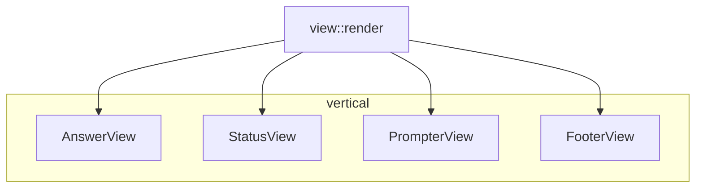

# 09 -- TUI Rendering

The TUI's core holds the state; the renderer turns it into a screen. This document covers the
four-pane layout, the indicator-bar blocks, the style system, and the prompt rendering. The
state it renders is described in [08-tui-core.md](./08-tui-core.md).

## The Problem It Solves

The terminal is a grid of character cells. The state is a struct full of `String`s, `Option`s,
and counts. Between them there is a question of layout, wrapping, color, and cursor placement.
The renderer answers all four, and it does so as a pure function of `(Frame, &mut TuiState)`.

The whole screen is one function.

```rust
// crates/zc-tui/src/view/main_view.rs:7
pub fn render(f: &mut Frame, state: &mut TuiState) {
    let prompt_h = PrompterView::height(state, f.area().width);
    let chunks = Layout::default()
        .direction(Direction::Vertical)
        .constraints([
            Constraint::Min(0),                // Content
            Constraint::Length(2),             // Status
            Constraint::Length(prompt_h),      // Input
            Constraint::Length(1),             // Footer
        ])
        .split(f.area());

    f.render_widget(Block::new().style(style::STL_BKG), f.area());

    AnswerView::render(f, chunks[0], state);
    StatusView::render(f, chunks[1], state);
    PrompterView::render(f, chunks[2], state);
    FooterView::render(f, chunks[3], state);
}
```

Four vertical panes. The content area takes all remaining space (`Min(0)`). The status line is
fixed at two rows. The input is as tall as the prompt needs, up to a cap. The footer is one
row. Every pane is a separate view module with its own `render`.



## The Answer Pane

`AnswerView` renders the content area, which is the prompt echo, the AI work block, and the
answer or error. It also owns the scrollbar.

```rust
// crates/zc-tui/src/view/answer_view.rs:12
pub fn render(f: &mut Frame, area: Rect, state: &mut TuiState) {
    let vertical_chunks = Layout::default()
        .direction(Direction::Vertical)
        .constraints([Constraint::Length(0), Constraint::Min(0), Constraint::Length(0)])
        .split(area);
    let content_area = Layout::default()
        .direction(Direction::Horizontal)
        .constraints([Constraint::Length(1), Constraint::Min(0), Constraint::Length(1)])
        .split(vertical_chunks[1])[1];

    state.set_scroll_area(ScrollIden::AnswerContent, content_area);

    let lines = build_content_lines(state, content_area.width);
    let line_count = lines.len();
    let scroll = state.clamp_scroll(ScrollIden::AnswerContent, line_count);

    f.render_widget(Block::new().style(style::STL_ANSWER), area);
    let content = Paragraph::new(lines).scroll((scroll, 0));
    f.render_widget(content, content_area);

    let content_size = line_count.saturating_sub(content_area.height as usize);
    let mut scrollbar_state = ScrollbarState::new(content_size).position(scroll as usize);
    let scrollbar = Scrollbar::default()
        .orientation(ScrollbarOrientation::VerticalRight)
        .begin_symbol(Some("▲"))
        .end_symbol(Some("▼"));
    f.render_stateful_widget(scrollbar, area, &mut scrollbar_state);
}
```

One side effect hides here: `set_scroll_area`. The renderer records the content rectangle into
the state's scroll-zone registry, which [08-tui-core.md](./08-tui-core.md) uses to route mouse
wheel events. The renderer is the only thing that knows the rectangle, so it is the only thing
that can register it. This is a rare, deliberate render-to-state write, and it is a layout
position, not display data.

The scroll offset is clamped before rendering, so a window resize never leaves the view stuck
past the end of the content. The scrollbar position is derived from the same offset.

### The Content Sequence

`build_content_lines` assembles the body from state, with a fixed precedence.

```rust
// crates/zc-tui/src/view/answer_view.rs:42
pub fn build_content_lines(state: &TuiState, content_width: u16) -> Vec<Line<'static>> {
    let mut lines = Vec::new();

    if let Some(prompt) = state.last_prompt() {
        lines.extend(tblock::build_prompt_block(prompt, content_width));
    }
    if let Some(work_info) = state.ai_work_info() {
        if !lines.is_empty() { lines.push(Line::default()); }
        lines.extend(tblock::build_ai_work_block(work_info));
    }
    if let Some(err) = state.last_error() {
        if !lines.is_empty() { lines.push(Line::default()); }
        lines.extend(build_error_lines(err, content_width));
    } else if let Some(ans) = state.last_answer() {
        if !lines.is_empty() { lines.push(Line::default()); }
        lines.extend(tblock::build_answer_block(ans, content_width));
    }

    if lines.is_empty() {
        vec![Line::from(Span::styled(
            "No answer yet. Type a prompt and press Enter.".to_string(),
            style::STL_ANSWER_MUTED,
        ))]
    } else {
        lines
    }
}
```

Three sections, each optional, each separated by a blank line: the prompt echo, the AI work
block, and the answer. The error takes precedence over the answer — when both exist, the error
shows. An empty state shows a muted hint.

The error block parses its own structure. `build_error_block` recognizes a Lua stack trace and
styles its parts differently: the header line, the code lines, and the trace lines.

```rust
// crates/zc-tui/src/view/tblock/tblock_builder.rs:219
pub fn build_error_block(err: &str, content_width: u16) -> Vec<Line<'static>> {
    let bar_width = 2;
    let wrap_width = (content_width as usize).saturating_sub(bar_width).max(1);
    let mut lines = Vec::new();
    let mut in_stack_trace = false;

    for (idx, raw_line) in err.lines().enumerate() {
        let line = raw_line.replace('\t', "    ");
        let trimmed = line.trim();
        if idx == 0 {
            // header: prefix "Error: " unless already present
        } else if trimmed.starts_with("Stack traceback:")
            || trimmed.starts_with("Stack Trace:")
        {
            in_stack_trace = true;
            // ... styled as header ...
        } else if in_stack_trace || trimmed.starts_with("```") || trimmed.contains(" | ") {
            // ... styled as code ...
        } else if trimmed.is_empty() {
            // ... blank ...
        } else {
            // ... styled as body ...
        }
    }
    lines
}
```

The first line is a header, with `Error: ` prepended when the source did not already provide
it. Lines after a "Stack Trace" marker, and any line containing a Lua ` | ` code marker, are
styled as code. The rest is body. The result is that a raw Lua error string renders as a
structured, color-coded message with no further formatting upstream. The executor stores the
raw error; the renderer makes it readable.

## The Indicator Bar Blocks

Every content line carries a two-cell left gutter: the glyph `▌ ` (a block bar and a space).
The gutter's color encodes what kind of block the line belongs to.

```rust
// crates/zc-tui/src/view/tblock/tblock_types.rs:11
pub enum TBlockKind {
    Prompt,
    Answer,
    Error,
    Work,
    Running,
}
```

```rust
// crates/zc-tui/src/view/tblock/tblock_types.rs:58
pub fn bar_glyph(&self) -> &'static str {
    "▌ "
}
```

The `bar_style` maps each kind to a color: prompt is blue, answer is green, error is red, work
and running are yellow.

```rust
// crates/zc-tui/src/view/style/style_consts.rs:54
pub const CLR_BAR_PROMPT: Color = Color::Indexed(33);
pub const CLR_BAR_ANSWER: Color = Color::Indexed(46);
pub const CLR_BAR_ERR: Color = Color::Indexed(196);
pub const CLR_BAR_RUNNING: Color = Color::Indexed(226);
pub const CLR_BAR_WORK: Color = Color::Indexed(226);
```

`build_tblock` is the generic block builder. It wraps text to the content width, subtracts the
gutter width, and prepends the bar to every wrapped line.

```rust
// crates/zc-tui/src/view/tblock/tblock_builder.rs:69
pub fn build_tblock(kind: TBlockKind, text: &str, content_width: u16) -> Vec<Line<'static>> {
    let bar_width = 2;
    let wrap_width = (content_width as usize).saturating_sub(bar_width).max(1);
    let style = kind.content_style();

    if text.is_empty() {
        return vec![Line::from(vec![bar_span(kind), Span::styled("", style)])];
    }

    let mut lines = Vec::new();
    for raw_line in text.lines() {
        let normalized = raw_line.replace('\t', "    ");
        if normalized.is_empty() {
            lines.push(Line::from(vec![bar_span(kind), Span::styled("", style)]));
        } else {
            let wrapped = textwrap::wrap(&normalized, wrap_width);
            for cow_str in wrapped {
                lines.push(Line::from(vec![
                    bar_span(kind),
                    Span::styled(cow_str.into_owned(), style),
                ]));
            }
        }
    }
    if lines.is_empty() {
        lines.push(Line::from(vec![bar_span(kind), Span::styled("", style)]));
    }
    lines
}
```

Wrapping is handled by `textwrap`, which breaks on word boundaries at the given width. Tabs
are normalized to four spaces first. The result is a list of lines, each starting with the
colored bar.

The prompt, answer, work, running, and error builders all delegate here or apply the same
gutter pattern. This is why the whole content area has a consistent left margin.

## The AI Work Block

The AI work block is the one animated part of the screen. While running, it shows a
four-arrow `▶▶▶▶` sequence with a grayscale wave that moves.

```rust
// crates/zc-tui/src/view/tblock/tblock_builder.rs:48
pub fn running_arrow_spans(phase: usize) -> Vec<Span<'static>> {
    const ARROW_GRAYS: [Color; 4] = [
        Color::Indexed(238),
        Color::Indexed(243),
        Color::Indexed(248),
        Color::Indexed(255),
    ];

    let mut spans = Vec::with_capacity(5);
    spans.push(Span::styled("AI ", STL_TBLOCK_WORK_MSG));
    for i in 0..4 {
        let offset = (4 + (phase % 4) - i) % 4;
        let shade_idx = 3 - offset;
        let color = ARROW_GRAYS[shade_idx];
        spans.push(Span::styled("▶", Style::new().fg(color)));
    }
    spans
}
```

The phase advances once per redraw, and each arrow is shaded by its distance from the moving
bright spot. The phase is derived from `tick_phase` in
[07-event-infrastructure.md](./07-event-infrastructure.md), so the animation is driven by the
wall clock, not by a counter.

```rust
// crates/zc-tui/src/view/tblock/tblock_builder.rs:122
let phase = info
    .anim_phase
    .unwrap_or_else(|| zc_common::time::tick_phase(zc_common::time::now_micro(), 0.15, 4) as usize);
```

`build_ai_work_block` produces one line while running, and up to two lines when done. The done
state adds a second line with cost and token counts.

```rust
// crates/zc-tui/src/view/tblock/tblock_builder.rs:118
pub fn build_ai_work_block(info: &AiWorkInfo) -> Vec<Line<'static>> {
    let mut lines = Vec::new();

    if info.is_running {
        // ... bar + "AI ▶▶▶▶" + model + duration ...
    } else {
        // ... bar + "AI Done" + model + duration ...
    }

    if !info.is_running && (info.cost.is_some() || info.input_tokens.is_some() || info.output_tokens.is_some()) {
        let tok_str = // "in: N tk | out: N tk (R tk reas)"
        let line2_text = // "$0.12   - in: ..." or "in: ..." or "$0.12"
        lines.push(Line::from(vec![
            bar_span(TBlockKind::Work),
            Span::styled(line2_text, STL_TBLOCK_WORK_DETAIL),
        ]));
    }

    lines
}
```

The token counts use comma grouping, and the cost uses a fixed-width formatter. `format_cost`
shows up to four decimals but pads to at least two, so `0.2` becomes `$0.20`.

```rust
// crates/zc-tui/src/view/tblock/tblock_builder.rs:27
pub fn format_cost(cost: f64) -> String {
    let s = format!("{cost:.4}");
    let trimmed = s.trim_end_matches('0');
    if let Some(dot_idx) = trimmed.find('.') {
        let decimals = trimmed.len() - dot_idx - 1;
        if decimals < 2 {
            format!("${trimmed}{}", "0".repeat(2 - decimals))
        } else {
            format!("${trimmed}")
        }
    } else {
        format!("${trimmed}.00")
    }
}
```

The values come from the `Air` row via the state's `AiWorkInfo`, which
[05-executor.md](./05-executor.md) populates: `model`, `duration`, `cost`, and token counts.

## The Style System

Style is centralized in `style_consts.rs`. A small grayscale ramp plus a few accent colors is
all the palette uses.

```rust
// crates/zc-tui/src/view/style/style_consts.rs:6
pub const TXT_100: Color = Color::Indexed(255);
pub const TXT_200: Color = Color::Indexed(254);
pub const TXT_300: Color = Color::Indexed(253);
pub const TXT_500: Color = Color::Indexed(252);
pub const TXT_600: Color = Color::Indexed(248);
pub const TXT_700: Color = Color::Indexed(244);
pub const TXT_800: Color = Color::Indexed(242);
pub const TXT_900: Color = Color::Indexed(240);

pub const BKG_APP: Color = Color::Indexed(0);
pub const BKG_PANEL: Color = Color::Indexed(234);
pub const TXT_ERROR: Color = Color::Indexed(196);
```

Eight grays from `240` (darkest) to `255` (brightest), a black app background, a dark panel
background, and one error red. Every `STL_*` constant is a `Style` built from these, so colors
are never inlined in a view. The token is a semantic name (`TXT_MUTED`, `BKG_PANEL`), not a
raw number.

Two styles are dynamic and computed by a helper.

```rust
// crates/zc-tui/src/view/style/style_common.rs:4
pub fn style_status(has_error: bool, waiting: bool) -> Style {
    if has_error {
        style::STL_STATUS_ERR
    } else if waiting {
        style::STL_STATUS_WAITING
    } else {
        style::STL_STATUS_READY
    }
}
```

The status line is red on error, muted otherwise. The input is bright when ready and muted
while a run is waiting, so the user sees at a glance whether typing will do anything.

## The Prompt

The prompt is the only widget the user interacts with. `PrompterView::render` computes the
cursor position and draws the buffer.

```rust
// crates/zc-tui/src/view/prompter/prompter_view.rs:32
pub fn render(f: &mut Frame, area: Rect, state: &mut TuiState) {
    let input_area = area.inner(Margin { horizontal: INPUT_MARGIN_H, vertical: 0 });
    let input_style = style::style_input(state.is_waiting());
    f.render_widget(Block::new().style(style::STL_INPUT), area);

    state.prompter_mut().set_viewport_width(Self::text_width(area.width));
    state.prompter_mut().ensure_cursor_visible();
    let prompter_render = build_prompter_lines(state.prompter(), state.is_waiting());

    let input = Paragraph::new(prompter_render.lines)
        .block(Block::default().borders(Borders::TOP | Borders::BOTTOM).style(style::STL_INPUT_BORDER))
        .style(input_style);
    f.render_widget(input, input_area);

    if input_area.width > 0 && input_area.height > 2 {
        let (cursor_col, cursor_row) = prompter_render.cursor;
        let cursor_x = input_area.x.saturating_add(cursor_col)
            .min(input_area.x.saturating_add(input_area.width.saturating_sub(1)));
        let cursor_y = input_area.y.saturating_add(1).saturating_add(cursor_row)
            .min(input_area.y.saturating_add(input_area.height.saturating_sub(2)));
        f.set_cursor_position(Position::new(cursor_x, cursor_y));
    }
}
```

Three things happen. The prompt's viewport width is set from the layout, so soft wrapping
knows the real width. The cursor is made visible by adjusting the scroll. Then the buffer is
rendered and the terminal cursor is placed at the computed position.

The prompt buffer is rendered by `build_prompter_lines`, which puts a `> ` marker on the first
row and indents later rows.

```rust
// crates/zc-tui/src/view/comp/prompter.rs:12
pub const PROMPTER_MARKER: &str = "> ";
pub const PROMPTER_MARKER_WIDTH: u16 = 2;

pub fn build_prompter_lines(prompter: &PrompterState, waiting: bool) -> PrompterRender {
    let text_style = style::style_input(waiting);
    let text = prompter.text();
    let selection = prompter.selection();
    let rows = prompter.rows();
    let scroll = usize::from(prompter.scroll_y());
    let (cursor_row, cursor_col) = prompter.cursor_row_col();

    let lines: Vec<Line<'static>> = rows
        .iter()
        .enumerate()
        .skip(scroll)
        .take(usize::from(PROMPTER_MAX_ROWS))
        .map(|(idx, row)| {
            let marker = if idx == 0 { PROMPTER_MARKER.to_string() } else { " ".repeat(usize::from(PROMPTER_MARKER_WIDTH)) };
            let mut spans = vec![Span::styled(marker, text_style)];
            spans.extend(row_spans(text, row.start, row.end, selection.as_ref(), text_style));
            Line::from(spans)
        })
        .collect();

    let cursor_y = u16::try_from(cursor_row.saturating_sub(scroll)).unwrap_or(u16::MAX);
    let cursor_x = PROMPTER_MARKER_WIDTH.saturating_add(cursor_col);

    PrompterRender { lines, cursor: (cursor_x, cursor_y) }
}
```

The rows come from the layout module in [08-tui-core.md](./08-tui-core.md), already wrapped to
the viewport width. The marker is rendered only on the first row. The cursor position is
translated from buffer coordinates to screen coordinates, accounting for the marker width and
the scroll offset.

Selection rendering is a span split. `row_spans` slices a row into before-selection,
selection, and after-selection spans, with the selection styled as reversed video.

```rust
// crates/zc-tui/src/view/comp/prompter.rs:51
fn row_spans(
    text: &str,
    start: usize,
    end: usize,
    selection: Option<&Range<usize>>,
    text_style: Style,
) -> Vec<Span<'static>> {
    let Some(sel) = selection else {
        return vec![Span::styled(slice_text(text, start, end), text_style)];
    };
    let sel_start = sel.start.clamp(start, end);
    let sel_end = sel.end.clamp(start, end);
    if sel_start >= sel_end {
        return vec![Span::styled(slice_text(text, start, end), text_style)];
    }
    let mut spans = Vec::with_capacity(3);
    if sel_start > start {
        spans.push(Span::styled(slice_text(text, start, sel_start), text_style));
    }
    spans.push(Span::styled(slice_text(text, sel_start, sel_end), style::STL_INPUT_SELECTION));
    if sel_end < end {
        spans.push(Span::styled(slice_text(text, sel_end, end), text_style));
    }
    spans
}
```

The selection is clamped to the row, so a multi-row selection renders correctly on each row.

## The Status and Footer

The status line shows `Status: <text>` and, when the terminal is wide enough, the help text on
the right.

```rust
// crates/zc-tui/src/view/status_view.rs:10
const STATUS_MIN_WIDTH: u16 = 20;

pub fn render(f: &mut Frame, area: Rect, state: &TuiState) {
    let status_style = style::style_status(state.last_error().is_some(), state.is_waiting());
    let status = Paragraph::new(format!(" Status: {} ", state.status())).style(status_style);
    // ...
    let help = PrompterView::help_text();
    let help_w = u16::try_from(help.width()).unwrap_or(u16::MAX);
    if status_area.width >= help_w.saturating_add(STATUS_MIN_WIDTH) {
        // split: status left, help right
    } else {
        f.render_widget(status, status_area);
    }
}
```

The help text is hidden when the terminal is narrower than the help width plus 20 cells for
the status. This is a responsive detail: the same layout degrades gracefully on a narrow
window.

The footer is a static key hint, with optional memory and database metrics when the system
states panel is toggled.

```rust
// crates/zc-tui/src/view/footer_view.rs:17
let footer_text = " [Enter] Send  |  [\\ Enter] Newline  |  [/q] Quit  |  [Ctrl-c] Quit ";
```

The metrics (`Mem:` and `DB:`) are appended when `show_sys_states` is on, using the memory
formatters from [08-tui-core.md](./08-tui-core.md).

## The Aha Moment

**Aha:** The left gutter is not decoration; it is a semantic channel. Every content line —
prompt, answer, error, work — carries the same two-cell `▌ ` prefix, and only the color
changes. Blue means the user's prompt, green the model's answer, red an error, yellow work in
progress. The gutter gives the eye a single stable axis to read: scan the left edge and you
know the shape of the whole conversation at a glance, even when the text itself is wrapped and
scrolled. This is the terminal equivalent of the colored diff markers in a code review, and it
is what makes the otherwise sparse interface legible.

## Where This Is Headed

The state this renders is built in [08-tui-core.md](./08-tui-core.md). The time helpers that
drive the animation come from [07-event-infrastructure.md](./07-event-infrastructure.md). The
values displayed — model, duration, cost, tokens — are produced by the executor in
[05-executor.md](./05-executor.md) and stored on the `Air` row in
[02-domain-model.md](./02-domain-model.md).
