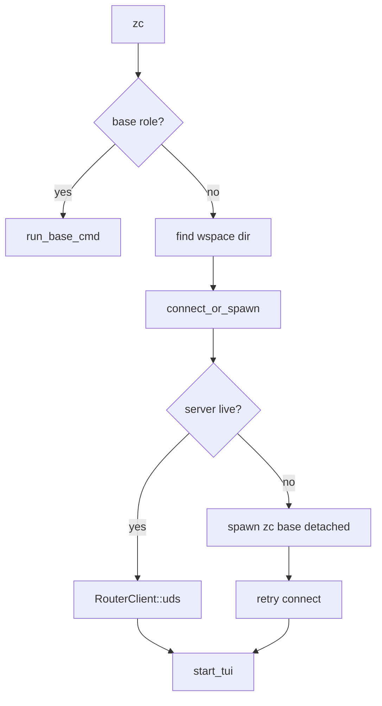
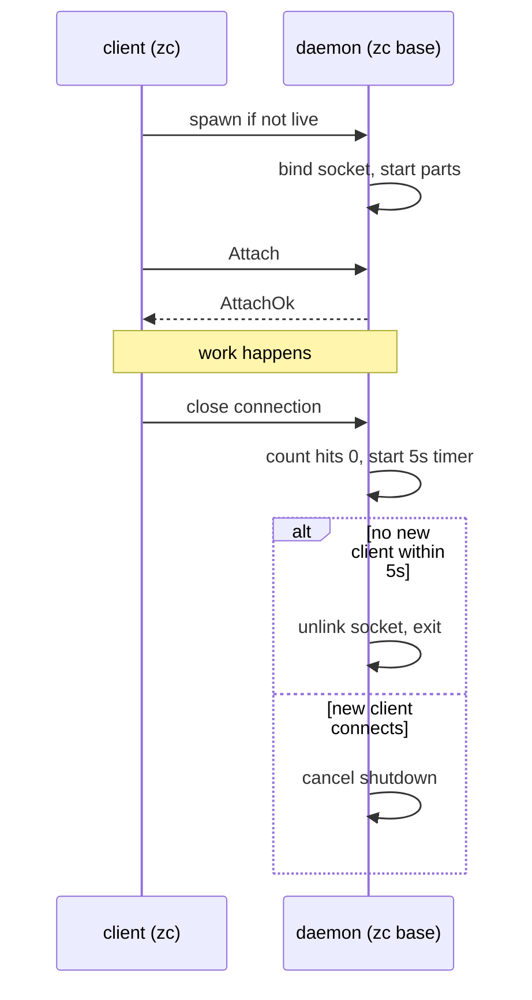

# 10 -- Bootstrap and Lifecycle

One binary, two roles. `zc` starts the TUI client; `zc base` starts the daemon. The client
spawns the daemon on demand, and the daemon shuts itself down when idle. This document traces
the whole lifecycle from a single command to a clean exit.

## The Problem It Solves

A coding agent needs a long-lived process to hold the database and run model calls. A user
should not have to start that process by hand. The answer is a self-spawning daemon: `zc`
checks for a live server, spawns `zc base` if none, waits for it, then talks to it over a Unix
socket. The split is invisible to the user, who only ever types `zc`.

The entry point chooses a role from the command line.

```rust
// src/main.rs:20
#[tokio::main]
async fn main() -> Result<()> {
    let cli_cmd = CliCmd::parse();

    if cli_cmd.base || matches!(cli_cmd.command, Some(SubCmd::Base)) {
        return base_cmd::run_base_cmd().await;
    }

    let from_dir = if let Some(dir) = cli_cmd.dir.as_deref() {
        SPath::from(dir)
    } else {
        simple_fs::current_dir()?
    };
    let wspace_dir = find_wspace_dir(&from_dir).unwrap_or(from_dir);

    // ... tracing setup ...

    let sock_path = socket_path();
    let client_info = ClientInfo::from_wspace_dir(wspace_dir.as_str());
    let client = base_spawner::connect_or_spawn(&sock_path, client_info).await?;

    zc_tui::start_tui(client, cli_cmd.prompt).await?;
    Ok(())
}
```

The command line has two spellings for the daemon role: the `base` flag and the `Base`
subcommand.

```rust
// src/cmd.rs:5
pub struct CliCmd {
    #[command(subcommand)]
    pub command: Option<SubCmd>,
    #[arg(long)]
    pub base: bool,
    pub prompt: Option<String>,
    #[arg(short, long)]
    pub dir: Option<String>,
}
```

```rust
// src/cmd.rs:21
pub enum SubCmd {
    Base,
}
```

A prompt argument runs one prompt and can then drop into the interactive loop. `--dir` forces
a workspace directory; without it, the current directory is used, walked up by
`find_wspace_dir` from [07-event-infrastructure.md](./07-event-infrastructure.md) to the
nearest `.zcoder` marker.



## The Client Spawns the Daemon

`connect_or_spawn` is the heart of the transparent daemon.

```rust
// src/base_spawner.rs:39
pub async fn connect_or_spawn(socket_path: impl AsRef<Path>, client_info: ClientInfo) -> Result<RouterClient> {
    let socket_path = socket_path.as_ref();
    match RouterClient::uds(socket_path, client_info.clone()).await {
        Ok(client) => return Ok(client),
        Err(err) => {
            if zc_router::transport::is_live(socket_path).await {
                return Err(err.into());
            }
        }
    }

    spawn_base_detached().await?;

    let start = std::time::Instant::now();
    let timeout = std::time::Duration::from_secs(5);
    let mut delay = std::time::Duration::from_millis(50);

    while start.elapsed() < timeout {
        tokio::time::sleep(delay).await;
        match RouterClient::uds(socket_path, client_info.clone()).await {
            Ok(client) => return Ok(client),
            Err(err) => {
                if zc_router::transport::is_live(socket_path).await {
                    return Err(err.into());
                }
                delay = (delay * 2).min(std::time::Duration::from_millis(250));
            }
        }
    }

    Err(Error::custom(format!(
        "could not connect to zc base at '{}' within timeout",
        socket_path.display()
    )))
}
```

Three phases. First, try to connect; if a server already answers, done. Second, if the socket
path is not live, spawn a detached daemon. Third, retry the connection with backoff — 50 ms,
doubling, capped at 250 ms — for up to 5 seconds. The `is_live` check distinguishes "the
daemon is still starting" from "the daemon is broken", and only a broken daemon aborts early.

`spawn_base_detached` re-runs the same binary with the `base` argument.

```rust
// src/base_spawner.rs:16
pub async fn spawn_base_detached() -> Result<()> {
    let current_exe = std::env::current_exe()
        .map_err(|err| Error::custom(format!("failed to get current executable path: {err}")))?;

    let mut cmd = std::process::Command::new(current_exe);
    cmd.arg("base")
        .stdin(std::process::Stdio::null())
        .stdout(std::process::Stdio::null())
        .stderr(std::process::Stdio::null());

    #[cfg(unix)]
    {
        use std::os::unix::process::CommandExt;
        cmd.process_group(0);
    }

    cmd.spawn()?;
    Ok(())
}
```

The child is fully detached: its stdio goes to null, and `process_group(0)` puts it in its own
process group so it does not receive Ctrl+C from the parent's terminal. The child is the same
executable, so there is no separate daemon binary to install or version to drift.

## The Daemon Starts

`run_base_cmd` owns the daemon side of the lifecycle.

```rust
// src/base_cmd.rs:9
pub async fn run_base_cmd() -> Result<()> {
    let zbase_dir = zbase_dir()?;
    simple_fs::ensure_dir(&zbase_dir)?;

    let _tracing_guard = init_base_tracing(&zbase_dir)?;

    let sock_path = socket_path();
    if is_live(&sock_path).await {
        eprintln!("Error: a live zcoder base server is already running on {}", sock_path.as_str());
        std::process::exit(1);
    }
    unlink_if_exists(&sock_path)?;

    let base_config = ZcBaseConfig::default();
    let BaseParts { exec_cmd_tx, model_rpc_cmd_tx, wspace_resolver, model_change_rx, exec_event_rx } =
        start_base_parts(base_config)?;

    let server = RouterServer::bind(&sock_path, exec_cmd_tx, model_rpc_cmd_tx, wspace_resolver, model_change_rx, exec_event_rx).await?;

    let conn_watch = server.conn_watch();

    let server_task = tokio::spawn(async move {
        if let Err(err) = server.run().await { tracing::error!("server run error: {err}"); }
    });

    tracing::info!("zc base server listening on {}", sock_path.as_str());

    tokio::select! {
        res = server_task => { /* ... */ }
        _ = run_idle_monitor(conn_watch) => { tracing::info!("idle monitor triggered shutdown"); }
        _ = tokio::signal::ctrl_c() => { tracing::info!("received SIGINT (Ctrl-C), shutting down"); }
        _ = sigterm() => { tracing::info!("received SIGTERM, shutting down"); }
    }

    let _ = unlink_if_exists(&sock_path);
    tracing::info!("zc base server stopped");
    Ok(())
}
```

The daemon refuses to start if a live server already owns the socket, then unlinks any stale
socket file, starts the base parts, binds the server, and waits. It exits when any of four
things happens: the server task ends, the idle monitor fires, Ctrl+C arrives, or SIGTERM
arrives. On the way out it unlinks the socket, so the next `zc` will not mistake a stale file
for a live server.

### The Base Parts

`start_base_parts` wires the base role's tasks.

```rust
// crates/zc-base/src/lib.rs:120
pub fn start_base_parts(config: ZcBaseConfig) -> crate::exec::Result<BaseParts> {
    let (executor, exec_cmd_tx, exec_event_source_rx) = Executor::new(config.into_executor_config())?;
    tokio::spawn(async move { if let Err(err) = executor.start().await { tracing::error!("executor error: {err}"); } });

    let (model_rpc_cmd_tx, model_rpc_cmd_rx) = new_model_rpc_cmd_channel();
    tokio::spawn(async move { run_model_rpc_handler(model_rpc_cmd_rx).await });

    let (model_change_tx, model_change_rx) = new_model_change_channel();
    tokio::spawn(async move { run_model_change_loop(model_change_tx).await });

    let (exec_event_tx, exec_event_rx) = new_exec_event_channel();
    tokio::spawn(async move { run_exec_event_loop(exec_event_source_rx, exec_event_tx).await });

    let wspace_resolver = std::sync::Arc::new(BaseWksResolver);

    Ok(BaseParts { exec_cmd_tx, model_rpc_cmd_tx, wspace_resolver, model_change_rx, exec_event_rx })
}
```

Four tasks start: the executor (from [05-executor.md](./05-executor.md)), the model RPC
handler (from [06-router-transport.md](./06-router-transport.md)), and two pump loops. The
pump loops translate internal events into router messages.

`run_model_change_loop` subscribes to the model bus and forwards each change with a workspace
scope.

```rust
// crates/zc-base/src/model_change.rs:6
pub async fn run_model_change_loop(model_change_tx: ModelChangeTx) {
    let mut model_rx = get_model_bus().subscribe();
    while let Ok(event) = model_rx.recv().await {
        let wspace_id = event.rel_ids.wspace_id.unwrap_or_default();
        let mut msg = RouterMsg::new(RouterMsgData::ModelChange(event));
        msg.wspace_id = wspace_id;
        if model_change_tx.send(msg).await.is_err() { break; }
    }
}
```

`run_exec_event_loop` resolves the workspace id for each run lifecycle event, by reading the
run row, before forwarding it.

```rust
// crates/zc-base/src/exec_event.rs:8
pub async fn run_exec_event_loop(mut exec_event_rx: ExecEventRx, exec_event_tx: RouterMsgTx) {
    while let Ok(exec_event) = exec_event_rx.recv().await {
        let run_id = match &exec_event {
            zc_core::exec::ExecEvent::RunStart(id) => *id,
            zc_core::exec::ExecEvent::RunEnd(id) => *id,
            zc_core::exec::ExecEvent::RunError(id) => *id,
        };
        let wspace_id = if let Ok(mm) = get_model_manager()
            && let Ok(run) = RunBmc::get(mm, run_id).await
            && let Some(wspace_id) = run.wspace_id
        {
            wspace_id
        } else {
            Id::default()
        };
        let mut msg = RouterMsg::new(RouterMsgData::ExecEvent(exec_event));
        msg.wspace_id = wspace_id;
        if exec_event_tx.send(msg).await.is_err() { break; }
    }
}
```

The executor does not know which workspace a run belongs to when it emits the event; the run
row does. This loop joins them, so the router's `client_filter` can deliver the event only to
the right workspace's client.

## Workspace Resolution and Asset Seeding

When a client connects, the server resolves its workspace. The resolver does two things:
materialize the workspace's `.zcoder/` assets, then get or create the workspace row.

```rust
// crates/zc-base/src/wspace_resolver.rs:8
impl WksResolver for BaseWksResolver {
    fn resolve<'a>(&'a self, info: &'a ClientInfo) -> BoxFuture<'a, zc_router::Result<Id>> {
        Box::pin(async move {
            let mm = get_model_manager().map_err(|e| zc_router::Error::custom(e.to_string()))?;
            if let Err(err) = zc_asset::update_wspace_dir(&info.wspace_dir) {
                tracing::warn!("->> failed to sync workspace assets for {}: {err}", info.wspace_dir);
            }
            let id = WksBmc::get_or_create_by_dir(mm, &info.wspace_dir, info.label.clone())
                .await
                .map_err(|e| zc_router::Error::custom(e.to_string()))?;
            Ok(id)
        })
    }
}
```

The asset seeding happens on every connect, before the directory is canonicalized into a row.
A fresh checkout gets its `.zcoder/config.toml` from the binary on first `zc` run, so the
config system in [03-config-system.md](./03-config-system.md) always has a workspace layer to
read.

## The Asset System

Assets are not loose files next to the binary. They are packed into a single zip, embedded at
compile time, and read back at runtime.

```rust
// crates/zc-asset/src/lib.rs:14
pub const ASSETS_ZIP: &[u8] = include_bytes!(env!("ASSETS_ZIP"));
```

`extract_asset` opens the zip from memory and reads one file by name.

```rust
// crates/zc-asset/src/lib.rs:39
pub fn extract_asset(path: &str) -> Result<Vec<u8>> {
    let normalized_path = path.trim_start_matches('/');
    let mut archive = ZipArchive::new(Cursor::new(ASSETS_ZIP))?;
    let mut file = archive.by_name(normalized_path)
        .map_err(|_| Error::AssetNotFound { path: path.to_string() })?;
    let mut content = Vec::with_capacity(file.size() as usize);
    file.read_to_end(&mut content)?;
    Ok(content)
}
```

Two asset groups are materialized. `update_zbase_assets` writes the base config files, with a
deliberate asymmetry.

```rust
// crates/zc-asset/src/lib.rs:120
pub fn update_zbase_assets(zbase_dir: impl AsRef<Path>) -> Result<()> {
    let zbase_dir = zbase_dir.as_ref();
    if !zbase_dir.exists() {
        std::fs::create_dir_all(zbase_dir)?;
    }
    let default_content = extract_asset(BASE_DEFAULT_ASSET)?;
    std::fs::write(zbase_dir.join(ZBASE_DEFAULT_FILE_NAME), default_content)?;

    let user_path = zbase_dir.join(ZBASE_USER_FILE_NAME);
    if !user_path.exists() {
        let user_content = extract_asset(BASE_USER_ASSET)?;
        std::fs::write(&user_path, user_content)?;
    }
    Ok(())
}
```

`config-default.toml` is always refreshed from the embedded asset, so an upgraded binary gets
the upgraded defaults. `config-user.toml` is written only when missing, so user edits are never
clobbered. The same rule governs `update_wspace_dir`: workspace assets are written only when
the destination does not exist.

```rust
// crates/zc-asset/src/lib.rs:85
pub fn update_wspace_dir(wspace_dir: impl AsRef<Path>) -> Result<()> {
    let wspace_dir = wspace_dir.as_ref();
    let zcoder_dir = wspace_dir.join(ZCODER_DIR_NAME);
    if !zcoder_dir.exists() {
        std::fs::create_dir_all(&zcoder_dir)?;
    }
    let asset_paths = list_asset_paths(WKS_ASSET_PREFIX)?;
    for asset_path in asset_paths {
        if let Some(rel_path) = asset_path.strip_prefix(WKS_ASSET_PREFIX) {
            let dest_path = zcoder_dir.join(rel_path);
            if !dest_path.exists() {
                // ... write ...
            }
        }
    }
    Ok(())
}
```

## The Idle Shutdown

The daemon does not run forever. It exits when the last client disconnects and stays away for
5 seconds.

```rust
// src/base_cmd.rs:96
async fn run_idle_monitor(mut conn_watch: ConnWatch) {
    loop {
        if conn_watch.count() == 0 {
            tracing::debug!("->> 0 clients connected, starting idle grace timer ({}s)", BASE_IDLE_GRACE_SECS);
            tokio::select! {
                _ = tokio::time::sleep(std::time::Duration::from_secs(BASE_IDLE_GRACE_SECS)) => {
                    if conn_watch.count() == 0 {
                        tracing::debug!("->> idle grace period expired with 0 clients, exiting");
                        break;
                    }
                }
                _ = conn_watch.wait_for_nonzero() => {
                    tracing::debug!("->> client connected, cancelling idle shutdown");
                }
            }
        } else {
            conn_watch.wait_for_zero().await;
        }
    }
}
```

The grace period is `BASE_IDLE_GRACE_SECS`, 5 seconds from
[07-event-infrastructure.md](./07-event-infrastructure.md). The monitor waits for the client
count to hit zero, then races the grace timer against a new connection. A new connection
cancels the shutdown; an empty 5 seconds ends the process. The double check after the sleep is
the race guard: a client that connected during the sleep cancels the exit.



## The Aha Moment

**Aha:** The client and the daemon are the same binary, and the client re-runs itself to start
the daemon. `spawn_base_detached` invokes `current_exe` with the argument `base`, detached into
its own process group with null stdio. There is no separate `zcoderd` binary, no install step
for a daemon, and no version skew between the two roles — they are literally the same file.
The client then probes the socket with exponential backoff until the freshly spawned daemon is
ready. The entire "start a server" ceremony that most client/server tools expose is collapsed
into one invisible step.

## Where This Is Headed

This document ties the whole system together. The parts started here are the executor in
[05-executor.md](./05-executor.md), the router in [06-router-transport.md](./06-router-transport.md),
the config in [03-config-system.md](./03-config-system.md), and the TUI in
[08-tui-core.md](./08-tui-core.md). The end-to-end trace is
[11-data-flow.md](./11-data-flow.md), and the lifecycle choices are revisited for production in
[12-cross-cutting.md](./12-cross-cutting.md).
