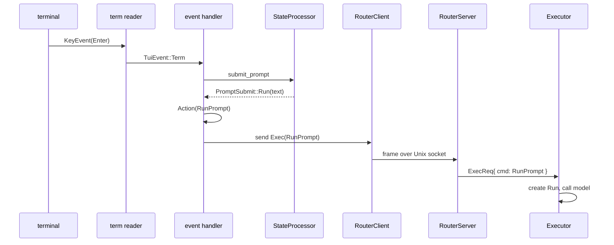
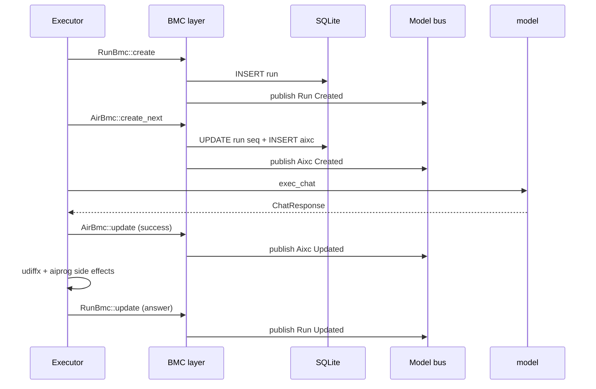
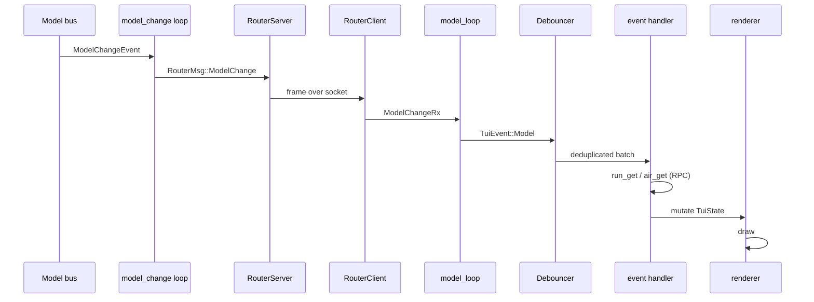
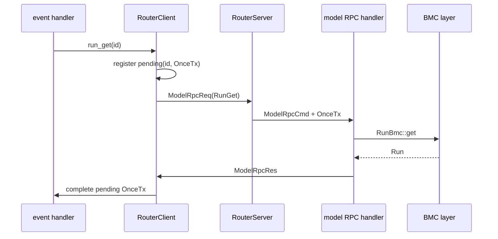
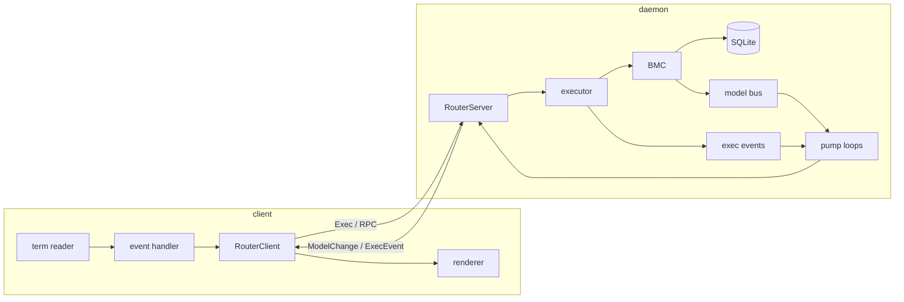

# 11 -- Data Flow

The previous documents described each layer in isolation. This document connects them: it
traces one prompt from a keystroke to a rendered answer, in both directions. It is the map of
the whole system.

## The Cast

Eight components participate in a single prompt round trip.

| Component | Document | Role |
|-----------|----------|------|
| Term reader | [08-tui-core.md](./08-tui-core.md) | reads keystrokes |
| Event handler | [08-tui-core.md](./08-tui-core.md) | turns keys into actions |
| Router client/server | [06-router-transport.md](./06-router-transport.md) | carries messages over the socket |
| Executor | [05-executor.md](./05-executor.md) | runs the model call and side effects |
| BMC layer | [04-persistence.md](./04-persistence.md) | writes and reads rows |
| Model bus | [04-persistence.md](./04-persistence.md) | broadcasts data changes |
| Event loops | [10-bootstrap-lifecycle.md](./10-bootstrap-lifecycle.md) | forwards changes back to the client |
| State/renderer | [08-tui-core.md](./08-tui-core.md), [09-tui-rendering.md](./09-tui-rendering.md) | updates and draws the screen |

## The Outbound Half: Keystroke to Model Call

The user types a prompt and presses Enter. The journey to the model has six hops.



The prompt is submitted only when it is non-empty and no run is in flight. The guard is in
`submit_prompt`.

```rust
// crates/zc-tui/src/core/tui_state/state_processor.rs:22
pub fn submit_prompt(state: &mut TuiState) -> PromptSubmit {
    if state.prompter_mut().continue_line() {
        return PromptSubmit::Newline;
    }
    let trimmed = state.prompter().text().trim().to_string();
    if trimmed == "/q" {
        return PromptSubmit::Quit;
    }
    if trimmed.is_empty() || state.is_waiting() {
        return PromptSubmit::Ignored;
    }
    state.prompter_mut().take_text();
    state.set_last_prompt(Some(trimmed.clone()));
    state.set_waiting(true);
    state.set_last_error(None);
    PromptSubmit::Run(trimmed)
}
```

The run is sent through the router as an `Exec` message.

```rust
// crates/zc-tui/src/core/tui_event_handlers.rs:123
AppActionEvent::RunPrompt(prompt) => {
    let msg = RouterMsg::new(RouterMsgData::Exec(ExecCmd::RunPrompt(prompt.clone())));
    if let Err(err) = client.send(msg).await {
        tracing::warn!("Failed to send prompt: {err}");
        StateProcessor::apply_prompt_send_error(state, prompt, err.to_string());
    }
    Ok(false)
}
```

A failed send restores the prompt text and shows an error, so the user's draft is not lost.
The executor receives the command on its single channel and runs it to completion, as
[05-executor.md](./05-executor.md) describes.

## The Processing Half: Inside the Executor

The executor turns the command into a run, an air request, and side effects.



Every write publishes a `ModelChangeEvent`. The sequence of events a client sees for one run
is: `Run Created`, `Aixc Created`, `Aixc Updated`, `Run Updated`. The run lifecycle events are
a separate stream: `RunStart`, then `RunEnd` or `RunError`.

## The Inbound Half: Event to Screen

The events travel back through the base's pump loops, the router, and the TUI's forwarders.



Two paths carry the two event kinds. The model changes come from the broadcast bus; the exec
events come from the executor's status channel. Both are forwarded through the router as
described in [10-bootstrap-lifecycle.md](./10-bootstrap-lifecycle.md).

The TUI's `model_loop` and `exec_loop` translate router messages back into TUI events.

```rust
// crates/zc-tui/src/core/model_loop.rs:8
pub async fn run_model_loop(tui_tx: TuiTx, mut model_change_rx: ModelChangeRx) {
    while let Ok(msg) = model_change_rx.recv().await {
        let RouterMsgData::ModelChange(model_event) = msg.data else {
            continue;
        };
        let res = tui_tx.send(TuiEvent::Model(model_event)).await;
        if res.is_err() { break; }
    }
}
```

The event handler re-fetches the changed row. A `Run` change pulls the run; an `Aixc` change
pulls the air request.

```rust
// crates/zc-tui/src/core/tui_event_handlers.rs:155
pub async fn handle_model_event(
    state: &mut TuiState,
    client: &RouterClient,
    model_event: ModelChangeEvent,
) -> Result<()> {
    if model_event.entity == zc_core::model::EntityType::Run {
        if let Some(run_id) = model_event.id
            && let Ok(Some(run)) = run_get(client, run_id).await
        {
            if let Some(prompt) = run.prompt {
                state.set_last_prompt(Some(prompt));
            }
            state.set_last_answer(run.answer);
            if let Some(error) = run.error {
                state.set_last_error(Some(error));
            }
        }
    } else if model_event.entity == zc_core::model::EntityType::Aixc {
        if let Some(air_id) = model_event.id
            && let Ok(Some(air)) = air_get(client, air_id).await
        {
            apply_air_state(state, &air);
        }
    }
    Ok(())
}
```

This is a pull-on-notify design. The event carries only the identity of the changed row; the
client fetches the row to learn its content. The router's RPC path from
[06-router-transport.md](./06-router-transport.md) is what `run_get` and `air_get` use.

## The RPC Round Trip

The read operations are the only synchronous round trips in the system. When the event handler
calls `run_get`, it blocks on a correlated reply.



The correlation is the `PendingRequest` map described in
[06-router-transport.md](./06-router-transport.md). The write path (the `Exec` command) is
one-way and has no reply; the read path (`ModelRpcReq`) is a request/reply. This asymmetry is
why the two flows are so different in cost: a write is fire-and-forget, a read waits.

## The Complete Picture

Putting both halves together, one prompt traverses the system as follows.



## The Aha Moment

**Aha:** The system has two event streams with opposite shapes, and it uses them for different
purposes on purpose. The model bus is a *broadcast* — every write fans out to every
subscriber, deduplicated by `(entity, id)` in the debouncer, because any client may care about
any row. The exec event channel is a *point-to-point* status stream — `RunStart`, `RunEnd`,
`RunError` — because exactly one client is driving a run at a time. The router wraps both in
the same envelope, but they are not the same thing, and the TUI's forwarder loops keep them
apart all the way to the event handler. Noticing the difference is what makes the flow legible:
broadcast carries *what changed*, the status stream carries *what happened*.

## Where This Is Headed

This is the last of the component documents. The remaining document,
[12-cross-cutting.md](./12-cross-cutting.md), steps back to discuss the Rust idioms at play,
what a production-grade version changes, and how to build a resilient storage system like this
one.
