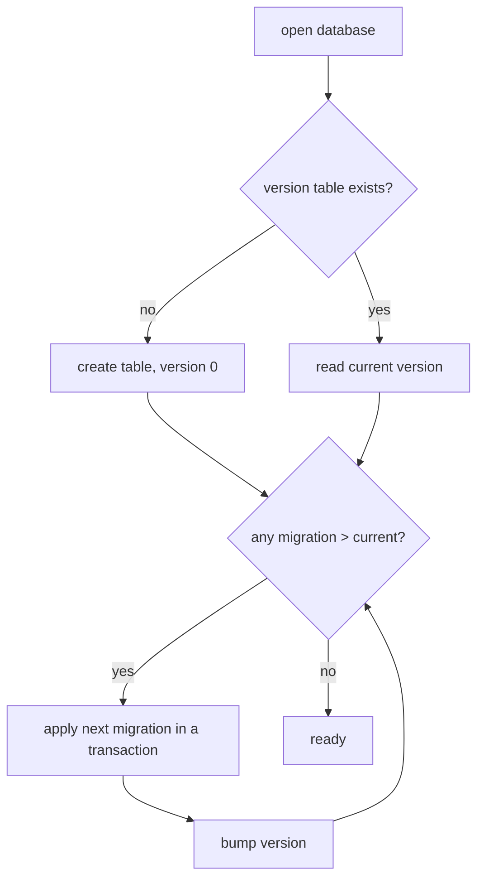

# 12 -- Cross-Cutting Concerns

This document steps back from the individual modules. It covers three things: the Rust idioms
that give the project its shape, what a production-grade version would change, and how to
build a resilient storage system like this one. It is the synthesis document.

## The Recurring Patterns

Seven patterns recur across every crate. Recognizing them is the fastest way to hold the whole
system in your head.

| Pattern | Where it appears | Why it recurs |
|---------|------------------|---------------|
| Single writer, many readers | executor, model bus, TUI state | eliminates data races by construction |
| `Arc` + interior mutability | `Db`, `Config`, `RouterClient` | cheap clones, safe sharing |
| `OnceLock` singleton | `ModelManager`, model bus, default asset | process-wide state without `unsafe` |
| Type-state create/update structs | `RunForCreate`, `AirForUpdate` | the compiler forbids wrong fields |
| Named, bounded channels | every `event_base` call | diagnostics + backpressure in one |
| `Drop` for teardown | `TermSetup`, `PendingRequest` | cleanup that cannot be forgotten |
| Copy-on-write snapshots | `ArcSwap<ConfigInner>` | lock-free hot reload |

Each is a standard Rust answer to a standard concurrency or safety question, and the project
uses them consistently rather than inventing new mechanisms.

## What This Looks Like in Rust

zcoder is already a Rust project, so this section is about the Rust decisions that give it its
character, and how they map to the concepts an engineer from another language needs.

### Ownership Makes the Topology Explicit

The single-writer executor is not enforced by a lock. It is enforced by ownership: the
`Executor` struct holds the only receiver of the command channel.

```rust
// crates/zc-base/src/exec/executor.rs:12
pub struct Executor {
    action_rx: ExecCmdRx,
    inner: ExecutorInner,
}
```

`action_rx` is not `Clone`, so exactly one task can drain it. There is nowhere to spawn a
second consumer, because the receiver is moved into `Executor` and `start` consumes `self`.
The "one task does all writes" guarantee is a type-level property, not a convention the team
must remember.

The database follows the same idea with `Arc<Mutex<Connection>>`.

```rust
// crates/zc-base/src/model/db/db_impl.rs:8
#[derive(Debug, Clone)]
pub struct Db {
    con: Arc<Mutex<Connection>>,
}
```

The `Connection` is wrapped in a `Mutex` so one task holds it at a time, and the `Arc` makes
the wrapper cheap to clone across tasks. Every BMC call locks for the duration of its
statement or transaction, then releases. The lock is the concurrency control.

### The Type System Replaces Validation Code

Create and update structs have no `id`, `ctime`, or `mtime` fields. The persistence layer
injects those. This is the Rust answer to "make illegal states unrepresentable": the struct
simply cannot carry a field the caller should not set.

```rust
// crates/zc-core/src/model/entities/run.rs:27
pub struct RunForCreate {
    pub wspace_id: Option<Id>,
    pub prompt: Option<String>,
    pub answer: Option<String>,
}
```

Compare with `Run`, which has eleven fields including `id`, `ctime`, `mtime`, `end`,
`end_state`, `total_cost`, and `air_idx_seq`. The create struct carries only the
three fields a caller owns; the rest are filled by `prep_fields`. A whole category of bugs —
a caller forgetting the id, or setting a wrong timestamp — cannot be written.

### Interior Mutability Is Localized

Global mutable state is avoided. Where a shared, lazily-initialized object is needed, `OnceLock`
provides it without `unsafe` and without a constructor that runs at process start.

```rust
// crates/zc-base/src/model/model_manager.rs:11
static INSTANCE: OnceLock<Result<ModelManager>> = OnceLock::new();

pub fn get_model_manager() -> std::result::Result<&'static ModelManager, String> {
    let res = INSTANCE.get_or_init(ModelManager::new);
    res.as_ref().map_err(|err| err.to_string())
}
```

The same pattern holds the model bus and the embedded default config. The point is that the
singleton is a *returned reference*, not a global that code mutates at will. It is initialized
once and read everywhere.

### Copy-on-Write Config

The config hot-reload uses `ArcSwap`, which is Rust's lock-free reader pattern.

```rust
// crates/zc-base/src/config/manager.rs:11
pub struct ConfigManager {
    config_path: SPath,
    default_config_path: Option<SPath>,
    current: ArcSwap<ConfigInner>,
    last_mtimes: Mutex<BaseMtimes>,
}
```

Readers get an `Arc` snapshot that stays valid even after a reload swaps in a new one. The
writer stores a new `Arc`; readers holding the old one are unaffected. This is the same
copy-on-write idea used in persistent data structures, applied to a config blob. It means
config reads never block on config writes.

### RAII for Side Effects

Terminal setup and RPC correlation both rely on `Drop` to clean up. The terminal restores
itself even on panic because `TermSetup`'s drop does it.

```rust
// crates/zc-tui/src/core/term_setup.rs:65
impl Drop for TermSetup {
    fn drop(&mut self) {
        if self.kbd_enhanced {
            let _ = execute!(stdout(), PopKeyboardEnhancementFlags);
        }
        let _ = execute!(stdout(), DisableMouseCapture, DisableBracketedPaste);
        ratatui::restore();
    }
}
```

The RPC pending entry is removed on drop, so a cancelled request does not leak.

```rust
// crates/zc-router/src/model_rpc.rs:261
impl Drop for PendingRequest<'_> {
    fn drop(&mut self) {
        self.client.remove_pending(self.msg_id);
    }
}
```

This is RAII: the compiler guarantees the cleanup runs, including on early return and on
cancellation, which is exactly the case where a hand-written cleanup would be forgotten.

### Typed Channels With Names

Every channel is named, and every disconnection maps to one error enum.

```rust
// crates/zc-common/src/event_base/event_base_error.rs:14
#[non_exhaustive]
pub enum EventBaseError {
    InvalidCapacity { name: &'static str, capacity: usize },
    TxDisconnected { name: &'static str },
    RxDisconnected { name: &'static str },
}
```

This is Rust's answer to "a thread died and I don't know which queue broke": the channel name
is in the error. In a Go program this would be a string in a log line; here it is a structured
field, carried by the error type all the way to the top.

### Summary of the Mapping

| Concept from another language | Rust equivalent in zcoder | Where |
|-------------------------------|---------------------------|-------|
| global singleton | `OnceLock<Result<T>>` | `ModelManager`, model bus |
| mutex-guarded handle | `Arc<Mutex<Connection>>` | `Db` |
| background thread | `tokio::spawn` + task | every loop |
| event queue | `MpscTx`/`MpscRx` | `event_base` |
| copy-on-write config | `ArcSwap` | `ConfigManager` |
| destructor / finally | `Drop` impl | `TermSetup`, `PendingRequest` |
| input validation | type-state structs | `ForCreate`/`ForUpdate` |

## What a Production Grade Version Looks Like

The current system is a working prototype with deliberate simplifications. Here is what a
production version changes, and why each change matters.

### Durable Storage

The database is in-memory. Every run is lost when the daemon exits. A production version
opens a file-backed SQLite database and runs migrations on startup. The `Db::new` call changes
from `open_in_memory` to `open(path)`, and a migrations table tracks schema versions. The
schema itself — `STRICT`, `WITHOUT ROWID`, `id BLOB` — carries over unchanged, because it is
already sound.

### Multiple Executors

One executor means one model call at a time per daemon. A production version runs a pool of
executors, each with its own command channel, and shards runs across them. The single-writer
invariant must then be per-run, not per-process. The `air_idx_seq` counter and `total_cost`
recompute already run inside transactions, so they extend to concurrency with no redesign.

### Streaming Responses

The model's answer arrives in full, then is rendered. A production version streams tokens and
updates the TUI as they arrive. This is the single biggest UX change. The `Air` row would gain
a partial-answer field, and the exec event stream would carry `RunProgress` events between
`RunStart` and `RunEnd`.

### Authentication and Isolation

The Unix socket is trusted by path. A production version restricts socket permissions to the
owning user, and adds an auth token for remote use. The `is_live` + `unlink` dance in
[06-router-transport.md](./06-router-transport.md) already handles stale sockets; the auth
token is the addition for untrusted peers.

### Model Fallback and Retry

A failed model call marks the run as errored and stops. A production version retries transient
errors with backoff, and falls back to a cheaper model when the primary is rate-limited. The
`get_model` resolution in [03-config-system.md](./03-config-system.md) already supports alias
chains; a `fallback` field in the config would give it a second target.

### Observability

Tracing writes to a file, and the debug cache dumps raw request/response payloads. A
production version ships those logs to a collector, adds structured spans around each run, and
exposes metrics for latency, token cost, and error rate. The `Air` row already records the
timings and cost; the gap is exporting them.

### Graceful Shutdown

The daemon unlinks the socket and exits on SIGINT/SIGTERM. A production version drains
in-flight runs before exit, waits for the executor to finish, and flushes the database. The
current shutdown is abrupt — an in-flight model call is simply dropped.

## How Do We Build a Resilient Storage System Like This, for an Inexperienced Engineer

This section teaches the storage discipline from first principles, using zcoder's persistence
layer as the running example. It assumes no prior database knowledge.

### What "Resilient" Means

A storage system is resilient when it survives three kinds of failure without losing or
corrupting data: a crash mid-write, a crash between writes, and a disk or process fault. The
answer to all three is the same idea: **never leave the data in a half-written state, and make
every change replayable or atomic.**

### Step 1: Write to a File, Not Just Memory

The current system keeps everything in RAM, which is why it loses data on exit. The first
change is to open a file-backed database.

```sql
-- the current schema, unchanged, but on disk
CREATE TABLE IF NOT EXISTS run (
        id BLOB PRIMARY KEY, wspace_id BLOB, prompt TEXT, answer TEXT,
        error TEXT, ctime INTEGER NOT NULL, mtime INTEGER NOT NULL,
        end INTEGER, end_state TEXT, model TEXT, total_cost REAL,
        air_idx_seq INTEGER NOT NULL DEFAULT 0
) STRICT, WITHOUT ROWID;
```

SQLite already writes to a file and, critically, does not acknowledge a write until it is
durable (when configured correctly). The application does not manage the file; it manages the
statements.

### Step 2: Wrap Every Multi-Statement Change in a Transaction

A single insert is atomic by itself. Two statements that must succeed or fail together — like
the `create_next` counter and its air row — must be in one transaction.

```rust
// crates/zc-base/src/model/bmc/air_bmc.rs:28 (abridged)
let id = db.exec_in_tx(|tx_db| {
    let new_idx = tx_db.exec_returning_as(
        "UPDATE run SET air_idx_seq = air_idx_seq + 1, mtime = ?2 WHERE id = ?1 RETURNING air_idx_seq",
        (run_id, now))?;
    // ... insert the aixc row with idx = new_idx ...
    Ok(id)
}).await?;
```

The transaction is the unit of atomicity. Either both the counter update and the row insert
happen, or neither does. The `exec_in_tx` helper commits on success and rolls back on error,
so the commit/rollback discipline is encoded once and reused everywhere.

### Step 3: Make Idempotent Writes Where Possible

An idempotent write can run twice and produce the same result. The workspace
`get_or_create_by_dir` is built on this idea: it inserts only when the row does not exist.

```rust
// crates/zc-base/src/model/bmc/wspace_bmc.rs:43 (abridged)
if let Some(wspace) = Self::get_by_dir(mm, &dir).await? {
    return Ok(wspace.id);               // already there
}
if let Some(id) = create_where_not_exists::<Self>(mm, fields, not_exists_fields, None).await? {
    return Ok(id);                      // we won the insert
}
let wspace = Self::get_by_dir(mm, &dir).await?; // someone else won; read it back
Ok(wspace.id)
```

Why does this matter for resilience? A retry after a crash must not create a duplicate. If a
client disconnects after sending "create workspace X" and reconnects, the retry lands on an
existing row instead of inserting a second one. The `UNIQUE` constraint on `dir` is the
database-level backstop that makes the "insert only when absent" race safe.

### Step 4: Understand the Write-Ahead Log

SQLite's durability comes from a write-ahead log (WAL). Instead of overwriting the database
file in place, it appends changes to a separate log file first, then periodically folds them
into the main file. If the process crashes mid-write, the main file is untouched and the log
is replayed or discarded on the next open.

For a beginner, the takeaway is: **durability is not "write to the file"; it is "write to the
log and fsync before acknowledging."** The `exec_in_tx` commit only becomes durable when
SQLite is configured to `synchronous=NORMAL` or `FULL`. Without that, a commit returns but the
data may still be in the OS page cache, not on disk.

### Step 5: Never Recompute What Can Be Stored, and Vice Versa

The system stores raw facts and recomputes aggregates. `total_cost` is recomputed from the
air rows rather than incremented.

```rust
// crates/zc-base/src/model/bmc/run_bmc.rs:50 (abridged)
pub async fn recompute_total_cost(mm: &ModelManager, run_id: Id) -> Result<f64> {
    let airs = AirBmc::list_for_run(mm, run_id).await?;
    let total_cost: f64 = airs.iter().filter_map(|a| a.cost).sum();
    // ... store total_cost ...
    Ok(total_cost)
}
```

This is a resilience choice, not just a design preference. A stored aggregate can drift from
its parts after a partial write; a recomputed one cannot. The rule: **store the source of
truth once, and derive everything else from it.** Aggregates are a cache, and a cache must be
rebuildable from the source.

### Step 6: Add Migrations

A schema changes over time. A production system needs a way to move an old database to a new
schema without data loss. The standard answer is a migrations table that records which
migration ran last, and a set of ordered migration scripts.



Each migration runs once, in a transaction, and bumps the version. A crash mid-migration
rolls back that migration, and the next start retries it. This is how the schema evolves
without manual intervention.

### Step 7: Back Up and Restore

Resilience also means surviving disk loss. SQLite's answer is the online backup API, which
copies a consistent snapshot to another file while the database stays in use. A production
deployment runs this on a schedule. The restore path is simply opening the backup.

### The Full Recipe

Putting it together, a resilient storage system like this needs, in order:

1. A file-backed database with the same strict schema.
2. Every multi-statement change inside a transaction, via a helper like `exec_in_tx`.
3. Idempotent inserts for anything that can be retried.
4. WAL mode with `synchronous` set so commits are durable.
5. Aggregates recomputed from source, never incremented.
6. A migrations table with ordered, transactional scripts.
7. Scheduled online backups.

The current codebase already has items 2, 3, and 5. Items 1, 4, 6, and 7 are the production
additions. The persistence design documented in [04-persistence.md](./04-persistence.md) is
the foundation; these are the hardening steps.

## The Aha Moment

**Aha:** The system never trusts an increment when it can trust a recomputation, and never
trusts a lock when it can trust a type. The cost total is recomputed from child rows, not
maintained as a running sum, because a running sum can drift and a recompute cannot. The
single-writer guarantee is ownership of an uncloneable channel, not a mutex convention,
because a type cannot be forgotten. Both are the same move: replace a thing the programmer
must remember with a thing the system enforces. That is the deepest thread running through
the whole codebase, and it is the single most transferable lesson to take from it.

## Where This Is Headed

This is the final document. The overview and architecture are in
[00-overview.md](./00-overview.md) and [01-architecture.md](./01-architecture.md). The
component deep dives run from [02-domain-model.md](./02-domain-model.md) through
[10-bootstrap-lifecycle.md](./10-bootstrap-lifecycle.md), and the end-to-end trace is
[11-data-flow.md](./11-data-flow.md).
